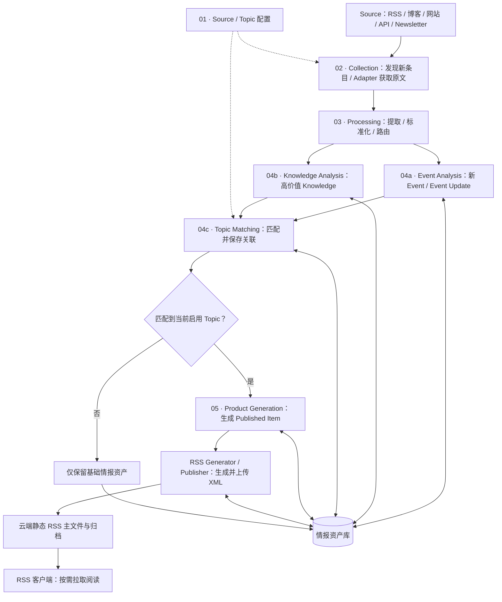
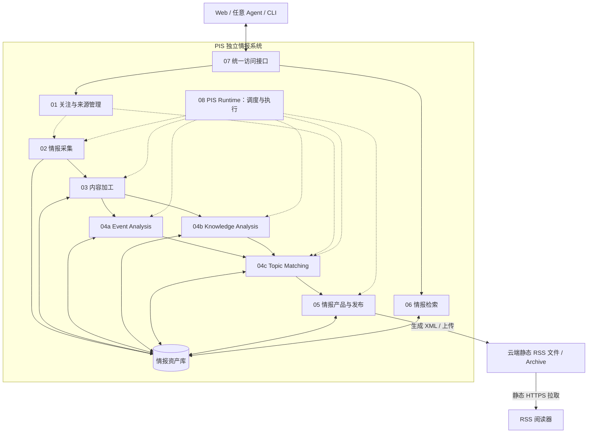
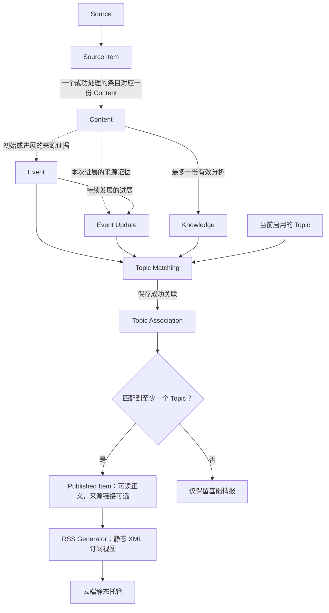

# PIS 个人情报系统 · 架构与设计原则

> **版本**：v1.0 · 2026-11-13（静态 RSS 已确认；Gitee Raw / GitHub Pages 候选渠道待选型）  
> **状态**：V1 业务架构基线、各阶段流程与五个功能 Prompt / User Context 均已复核；TypeScript + Node.js（不使用 Bun）及 Fastify、better-sqlite3、Zod、原生 fetch、node-cron、Pino、PM2 等实现选型已于 2026-11-14 同步至《技术实现设计》，具体兼容性待开发验证；P0 API 个别协议细节仍待确认  
> **本文职责**：系统定位、业务原则、逻辑模块、领域对象与关系、情报判定规则、业务场景及 V1 非目标。  
> **配套文档**：[PIS_数据库设计_v1.0.md](PIS_数据库设计_v1.0.md)、[PIS_技术实现设计_v1.0.md](PIS_技术实现设计_v1.0.md)

**文档边界**：本文件不再嵌入数据库 DDL、具体 HTTP 路由或 Runtime 实现契约；上述内容在独立文档中维护。三份文档以本文的领域语义为准。

---

## 1. 系统定位与目标

PIS（Personal Intelligence System，个人情报系统）是一套**独立运行、围绕用户关注主题持续发现、理解和发布增量信息的个人情报服务**。

系统持续读取用户订阅的信息源，将新条目加工为统一 Content，识别客观事件及其进展，以及值得阅读、学习、思考或使用的知识内容。情报在匹配至少一个当前启用的 Topic 后，保存**独立 Published Item**，由发布器生成 RSS 静态文件并上传至云端托管。用户使用自己的 RSS 客户端，按个人节奏查看标题、时间、内容与来源；Web、Agent 和其他客户端则可通过统一接口查询既有情报资产。

### 1.1 价值目标

1. **持续发现变化**：自动识别新事件与已有事件的实质进展。
2. **发现值得阅读的内容**：从博客、研究、深度文章、个人经验及实用工具中提取阅读、思考与使用价值。
3. **以 Topic 表达关注**：用户定义关注的领域、对象及具体事项；系统据此建立关联并决定发布范围。
4. **按条目、按需阅读**：情报一旦准备好即可发布，用户自行选择何时阅读、读哪些条目。
5. **积累可追溯情报**：保留 Content、Event、Knowledge、Topic 关联及 Published Item，支持来源追溯和历史检索。

### 1.2 系统边界

- PIS 具备完整的来源管理、采集、加工、分析、Topic 匹配、RSS 发布和历史检索能力，可独立运行。
- Web、任意 Agent、CLI 等通过统一接口访问 PIS，外部客户端可独立更换。
- PIS 自行维护 Topic 与情报资产，并与其他个人上下文、记忆系统保持独立生命周期。
- Source 表示信息供给；Topic 表示关注范围；RSS 表示情报对外发布；Retrieval 表示历史资产的查询。
- 文中的模块均为**逻辑业务边界**，不等同于独立服务、独立进程或独立数据库。

### 1.3 V1 非目标（已明确排除）

- **不设置手工投递内容的独立入口**：发现值得关注的文章时，以配置长期 Source／作者渠道为主，不为单篇手工提交另建分析链路。
- **不设置独立 Watch Task / Watch Engine**：长期关注由 Topic 表达；Topic Matching 直接建立并保存关联，不再增加独立 Watch、Topic Filtering 或 Association 处理阶段。
- **不设置重大事件告警或独立重要性评分体系**：不引入 Topic Priority、事件严重度／重要性评分及单独通知流程。
- **不设置定时日报／早晚报作为独立产品**：V1 仅逐条产生 Event Updates 与 Curated Content，经 RSS 供客户端自主拉取；阅读时间由用户自行决定。
- **不进行历史 Topic 回溯匹配或基于重匹配的 RSS 补发**：Topic 新建、修改或重新启用只影响后续实际执行的匹配；不追溯过去的情报资产；已发布历史通过云端静态 RSS 归档访问。

上述非目标是 V1 业务边界，不妨碍未来按实际需要重新评估，但不得在 V1 开发中自动恢复为默认功能。

---

## 2. 正式设计原则与约束

### P1. 以真实业务职责划分模块

模块根据**独立的业务判断与数据归属**划分。判断、保存结果及记录该业务操作的状态，共同构成同一职责。以最小且清晰的模块划分支撑个人系统长期维护。

### P2. 由持续 Source 驱动信息输入

用户配置长期订阅的信息来源。Collection 按来源持续发现**新发布的条目**，Processing 将它们统一加工为 Content，供不同分析路径复用。

### P3. 按来源新条目接入，处理单位清晰

来源可识别的新发布条目进入正常流程；是否已采集仅根据来源现有标识判断（优先 `external_id`，否则 URL + 发布时间），不单独判断“重新发布”。使用相同原文 URL 但能按上述规则识别为新条目的输入仍可进入流程；难以区分的重发或重复，V1 接受少量漏采／重复。

### P4. Content、Event、Knowledge、Topic 各司其职

- **Collection**：按 Source Adapter 获取来源条目并尽力获取正文；Adapter 自行判断条目已有正文是否可直接使用，必要时访问原文，失败时保留可用的来源正文或摘要。
- **Processing**：消费已采集的 Source Item 正文、解析与标准化，**先持久化 Content，再判断分析路由**；不联网抓取原文，**不判断跨 Content 重复**。
- **Event Analysis**：以核心实体（Entity）、事项主题（Subject）与信息主线范围（Scope）组织 Event，识别新信息主线、新进展与重复报道，维护事件历史及核心实体别名。
- **Knowledge Analysis**：识别并描述内容的思想、经验、方法、资源等知识和阅读价值。
- **Topic Matching**：依据当前启用的 Topic 匹配新情报，并保存有效关联。

不同环节使用上游结果，保持明确的数据归属。

### P5. 一份内容可以具有多类信息价值

事件事实与高价值知识属于不同业务视角。同一 Content 在确有需要时可同时形成 Event / Event Update 和 Knowledge 结果，且共享原文及基础加工结果。

### P6. Topic 是用户关注范围的唯一业务表达

Topic 用名称和 Description 表达完整关注范围。一条情报可关联多个 Topic；匹配发生时直接保存关联。**每次 Topic Matching 使用执行当时启用的 Topic 配置。**

### P7. 情报增量由各分析模块负责

Event Analysis 决定新事件或新进展是否成立；Knowledge Analysis 决定新内容是否具有值得记录的知识与阅读价值；Topic Matching 只判断属于哪些关注主题。

### P8. 有效情报逐条发布，产品边界明确

**Event Updates** 以新 Event / Event Update 为发布单位；**Curated Content** 以高价值 Knowledge 为发布单位。每个通过 Topic Matching 的有效业务结果可以形成独立 Published Item，发布到 RSS 供客户端拉取。

### P9. 情报资产、发布结果和阅读体验分离

Event、Knowledge 与 Content 保留为基础情报资产；Published Item 表示对外发布的可阅读内容快照，正文尽可能附带已有的真实来源链接，但**缺少链接不阻断发布**；RSS 是从 Published Item 生成并上传到云端的静态订阅视图，SQLite 始终是权威数据源；用户的已读、稍后阅读和收藏等阅读行为由 RSS 客户端管理。

### P10. 历史可检索、证据可追溯

Event 维护围绕事项主题持续发展的历史与 Content 来源证据，并允许从新 Content 中补充有出处的核心实体别名；Knowledge 关联原始 Content；Topic 信息流由已保存的关联形成；Published Item 的正文直接提供真实来源链接，同时可通过目标情报追溯 Content、Source Item 和 Source；Retrieval 基于保存的资产提供查询能力。

### P11. V1 以简单执行和可接受的容错为原则

PIS 是个人信息消费系统，V1 优先保证核心信息发现与发布链路简洁可运行。采集定时触发、后续处理由结果驱动，保留基础运行日志；允许少量漏报或重复，不以严格一致性和复杂的任务保障机制作为第一版前提。

---

## 3. 总体架构

### 3.1 业务主链路



**主链路含义**：采集新来源条目 → 形成标准化 Content → Event / Knowledge 产生有效情报 → 使用匹配时当前启用的 Topic 建立关联 → 至少匹配一个 Topic 后生成 Published Item（SQLite 持久化）→ 生成/上传云端静态 RSS XML → RSS 客户端仅从云端拉取。

### 3.2 八个逻辑模块与外部访问



> 模块 04 内包含 Event Analysis、Knowledge Analysis 和 Topic Matching 三种业务能力。图中的连接描述主要逻辑关系，具体同步／异步组织、存储与部署方式由后续技术设计决定。

### 3.3 模块清单与职责

| 编号 | 模块 | 核心职责 | 主要业务结果 |
|---|---|---|---|
| **01** | **关注与来源管理** | 管理 Source、Topic 及基本采集配置 | Source、Topic |
| **02** | **情报采集（Collection）** | 定时获取来源新条目，使用 Source Adapter 尽力获得原文正文：已有可用全文直接返回，否则按来源规则抓取并在失败时保留已有内容 | Source Item 与已获取原文 |
| **03** | **内容加工（Processing）** | 使用 Source Item 中已获取的数据解析、清洗并创建独立 Content；保存成功后执行分析路由，不负责网络正文获取或跨 Content 去重 | Content 与后续分析路由 |
| **04** | **情报分析与组织** | Event、Knowledge 分析和 Topic Matching | Event、Event Update、Knowledge、Topic 关联 |
| **05** | **情报产品与发布（Product & Publication）** | 生成 Published Item；提交后生成并上传云端静态 RSS 主文件与归档，提供与 PIS 运行地址无关的订阅 URL | Published Item、静态 XML 发布产物 |
| **06** | **情报检索（Intelligence Retrieval）** | 查询已有 Topic、Event、Knowledge 和 Published Item 等历史资产 | 检索与关联查询结果 |
| **07** | **统一访问接口（Unified API）** | 向 Web、任意 Agent、CLI 等提供统一配置与查询能力 | 中立的对外接口 |
| **08** | **PIS Runtime（调度与执行）** | 管理 Scheduler、各异步模块的内存队列及 Worker、有限重试与基础日志 | 运行生命周期与执行记录 |
| **DATA** | **情报资产库** | 保存来源、Content、分析结果、Topic 关联与发布历史 | 统一可追溯资产 |

---

## 4. 核心领域模型（逻辑层）

### 4.1 七个核心业务对象

| 对象 | 主要业务字段 | 业务职责与归属 |
|---|---|---|
| **Source** | `id`、`name`、`type`、`url`、`cron`、`enabled`、`description?`；运行状态 `last_collected_at?` | 长期订阅来源及采集配置；上次成功采集时间为运行检查点，模块 01 / 02 |
| **Content** | `id`、`title`、`url?`、`author?`、`published_at?`、`created_at`、`body`、`summary?`、`language?`、`completeness` | 标准化来源内容；`created_at` 表示本 Content 在 PIS 中创建的时间，模块 03 |
| **Event** | `id`、`title`、`entity`（`name`、`aliases`）、`subject`、`scope`、`description`、`occurred_at?`、`discovered_at` | 以 Entity + Subject + Scope 表示可持续发展的信息主线，模块 04 Event |
| **Event Update** | `id`、`event_id`、`title`、`description`、`occurred_at?`、`discovered_at` | 同一 Event 的独立实质进展，模块 04 Event |
| **Knowledge** | `id`、`content_id`、`title`、`summary`、`category?`、`findings`、`value` | 一份 Content 最多形成一份有价值 Knowledge，Finding 是内部结构，模块 04 Knowledge |
| **Topic** | `id`、`name`、`description`、`enabled` | 用户关注范围及匹配配置，模块 01 / 04 Topic |
| **Published Item** | `id`、`target_type`、`target_id`、`title`、`summary`、`body`、`published_at` | 完整、独立可阅读的 RSS 情报快照，可选择附加真实原文链接（无链接仍可发布），模块 05 |

本节优先描述**领域语义**；Source 的 `last_collected_at` 是运行状态，Content 的 `created_at` 是记录创建时间。具体表结构与最小索引约定见《数据库设计》；`?` 表示可选信息，Published Item 的完整生成约束见第 8 章。

### 4.2 辅助记录与关联

核心领域对象不需要因多来源证据、关注关联或运行日志而额外扩展为新的顶层业务模块。

| 辅助记录 / 内部数据 | 最小信息或关系 | 主要作用 |
|---|---|---|
| **Source Item** | `id`、`source_id`、`external_id?`、`url?`、`title?`、`published_at?`、`discovered_at`、`content_id?`、`raw_data?` | Collection 对来源发布条目尽力去重，不引入 `entry_key`；V1 一条成功处理的 Source Item 独立对应一份 Content，不跨来源复用 Content |
| **Content 证据关联** | Event 或 Event Update ↔ Content | 保存初始事实和新进展的依据；同一进展可由多份 Content 支持 |
| **核心实体别名证据** | Event 的核心 Entity 别名及支持它的 `content_id` | 为自动补充的可靠别名提供可追溯出处；不新增独立 Entity 注册表 |
| **Topic Association** | `topic_id`、`target_type`、`target_id`、`matched_at` | 关联 Topic 与已匹配的 Event / Event Update / Knowledge |
| **Finding** | Knowledge 内的发现标题与内容 | 一篇文章可有多个发现；无独立 ID 或生命周期 |
| **Runtime 记录** | 来源检查结果、必要错误日志 | 支持 V1 的轻量运行观察，无持久化任务保障体系 |

**证据关联的 V1 粒度**：一条 Event Update 可以关联多个 Content；一篇 Content 对同一个 Event 通常只形成一次新 Update，多个相关新事实可以组织为该次 Update。如果文章涉及不同 Event，可以分别提供证据。对于文章仅回顾的全部历史进展，不强制建立引用关系。实现上可以用轻量关联记录，不引入独立的证据审核、评分或管理流程。

### 4.3 对象关系及发布门槛



**发布的硬性前置条件是：有效新情报经过 Topic Matching，且匹配至少一个启用 Topic。** Event / Event Update / Knowledge 本身不能绕过该条件直接生成 Published Item。

每个 Published Item 通过 `target_type + target_id` 引用一个具体情报结果：`EVENT`、`EVENT_UPDATE` 或 `KNOWLEDGE`。同一有效情报结果在**正常业务执行**中最多生成一条 Published Item；匹配多个 Topic 不会生成多份相同条目。V1 不承诺进程异常时严格 Exactly-once。

### 4.4 从 RSS 到原始来源的两种追溯路径

- **有链接时直接验证**：RSS 阅读器 → Published Item 的 `body` → 可点击的原始公告、报道或文章链接；若没有可用链接，正文仍可独立阅读，不虚构来源。
- **内部历史追溯**：Published Item → `target_type + target_id` → Event / Event Update / Knowledge → Content → Source Item → Source。对于 Event Update，可继续经 `event_id` 查看完整 Event 历史。

这两条路径彼此补充：`body` 中的链接是当时发布的内容快照，而业务对象关联提供结构化来源、事件历史和后续检索能力。

---

## 5. Source → Collection → Processing

### 5.1 Source 与采集

Source 包含来源身份、地址、采集方式、**Cron 采集计划**和启用状态等基本配置，并保存可选的 `last_collected_at`（上次**成功完成来源检查且采集结果已保存**的时间）作为采集检查点；Source 不维护 Topic 关联，实际情报的关注主题归属仅由后续 Topic Matching 判断。Cron 的具体语法与时区规则在 Runtime 技术实现时统一确定。

Collection 按 Source 的 Cron 计划检查新增条目：先由 Source Adapter 获取来源条目，再按来源已有的 `external_id`（优先）或 URL + 发布时间识别未采集条目；不单独判断重新发布。**只对新条目调用 Adapter 的 `fetchContent(entry)` 尽力获取正文**：若 entry 已有完整正文，可直接使用；否则由对应 Adapter（例如 `RssAdapter`）根据原文 URL 获取正文，抓取失败时保留来源自带正文／摘要。Adapter 负责外部 HTTP 与网页正文提取，Collection 将获取结果和来源元数据保存在 Source Item 的 `raw_data` 等现有字段。来源支持可靠的增量查询时可使用 `last_collected_at`；对 RSS 不以 `published_at > last_collected_at` 硬过滤。不同来源即便转载同篇文章，也分别保留 Source Item 和 Content；事件事实重复仍交由 Event Analysis 判断。

### 5.2 Content 与处理规则

Processing 以 Collection 提供的 **Source Item** 为输入，读取 Adapter 已经保存的正文或摘要，在**不发起外部抓取**的前提下完成解析、清洗和格式标准化。若内容可用，**先在同一短事务中创建独立 Content 并写入 `source_items.content_id`，提交成功后才调用 `routeContent(content)`** 选择 Event、Knowledge、双路径或无路由。`FULL` / `PARTIAL` 依据实际已有内容判断；无有效内容则不创建 Content。**V1 不进行跨 Content 去重、相似度计算或复用其他 Source Item 的 Content**。

**处理约束**：同一 Source Item 不会重复创建 Content；但若 Content 已保存而 `routeContent` 失败，重试 ProcessTask 时应读取原 Content 并继续路由，不重复创建。即使路由集合为空，也保留有效 Content；这不是跨文章去重。具体短事务、结果派发与伪代码见《数据库设计》及《技术实现设计》。

**V1 采用来源条目驱动的增量规则，不新增 `entry_key` 字段：**

- 来源发布新条目时，进入常规采集和 Processing；同一次来源发布在后续定时检查中重复出现，应利用来源已有标识尽力避免重复处理。
- `isCollected` 不单独判断重新发布：优先比较 `external_id`；没有该标识时比较 URL 与发布时间。新标识或新组合可以形成新 Source Item；相同标识即使来源实际上重发也可能被视为旧条目。
- 来源只修改原页面且没有产生可识别的新条目时，不主动刷新旧 Content；现有标识无法区分重发与重复时，V1 接受少量遗漏或重复。
- 不对跨源转载、镜像文章或重复报道做 Content 级归并；Collection 只判断同一次来源发布是否已采集，Event Analysis 负责事件及进展级去重。

上游对重新发布内容完成接入后，**Event Analysis** 判断是否构成新 Event、新进展或重复报道；**Knowledge Analysis** 只判断本次实际进入分析的 Content 是否独立具有足够知识价值，**不与历史 Knowledge 比较语义增量**。**无需主动跟踪既有 Content 的页面版本。**

### 5.3 基础时间信息

- `Source.last_collected_at`：PIS 上次成功完成该 Source 采集、且采集结果已保存的时间；采集失败不推进此检查点。此时间是**采集执行时间**，不等于文章的原始发布时间。
- `Source Item.published_at`：来源提供的该次发布实例时间（可能为空）；`Source Item.discovered_at`：PIS 首次看到该发布条目的时间。
- `Content.published_at`：原始文章的发布时间（可能为空）；`Content.created_at`：该 Source Item 产生的 Content **记录在 PIS 中创建的时间**，不再使用 `Content.discovered_at`。不同 Source Item 即使正文相同，也各有自己的 Content 和 `created_at`。
- `Event`、`Event Update` 保留各自的 `discovered_at`，表示 PIS 首次识别信息主线或本次有效进展的时间，业务语义不同，不随本次调整改名。

以上时间在数据库中使用统一格式；来源重发形成新的 Source Item 时，成功加工后产生新 Content，不修改任何历史 Content 的创建时间。

---

## 6. Event / Knowledge Analysis

### 6.1 Event Analysis

#### 6.1.1 Event 的业务定位与身份

**Event 不是一条新闻，也不要求对应唯一案件或单次客观行动；Event 是围绕特定核心实体和事项主题持续发展的信息主线。**

- **Entity（核心实体）**：这主要是谁或什么对象的事情。V1 只保留决定信息主线身份的主要实体及其已确认别名，不枚举报道中所有组织、人物或产品。必要时未来再扩展多核心实体的表达。
- **Subject（事项主题）**：围绕该实体正在发生、发展或被讨论的核心事项，例如反垄断监管、某代产品的研发与商业化。
- **Scope（语义范围）**：信息主线覆盖的边界与连续发展含义，辅助判断新报道是否归属已有 Event。Scope 不要求相同国家、监管机构、独立案件或时间段；也不能宽泛到等同于 Topic。
- **Event ID**：系统生成的稳定技术身份，不从标题、Entity、Subject 或内容哈希推导；新进展不改变已有 Event ID。

**术语边界**：`Event.entity` 是事件身份中的核心对象信息，不表示 V1 新增了独立 Entity 领域对象或注册表；`Event.subject` 是该事件的事项主题，与用户配置的关注主题 `Topic` 不同。

例如：`Topic = 星云科技` 表示用户关注该公司；`Event = 星云科技面临反垄断监管` 表示一条信息主线；不同监管机构的调查、处罚、上诉等具体变化可以构成同一 Event 的不同 Event Update。只要具有共同业务含义，不以“不是同一个案件”为由强制拆分。

#### 6.1.2 Event / Event Update 的主要字段（逻辑模型）

| 对象 | 字段 | 语义 |
|---|---|---|
| **Event** | `id` | 稳定 Event ID |
| Event | `title` | 可读的信息主线标题 |
| Event | `entity` | 核心实体的规范名称（`name`）及已确认别名（`aliases`） |
| Event | `subject` | 事项主题，采用简洁自然语言表达 |
| Event | `scope` | 该信息主线的语义范围与边界 |
| Event | `description` | 初始背景和已知事实 |
| Event | `occurred_at`（可选） | 初始事项发生时间，可能未知 |
| Event | `discovered_at` | PIS 首次识别时间 |
| **Event Update** | `id` | 独立进展身份 |
| Event Update | `event_id` | 所属 Event |
| Event Update | `title`、`description` | 该次真正新增或修正的事实与说明 |
| Event Update | `occurred_at`（可选）、`discovered_at` | 进展发生与 PIS 发现时间 |

首次发现一条信息主线时**直接创建 Event，保存初始事实，无需额外创建“初始 Event Update”**。后续进展才新增 Event Update。事件最近进展时间可由已有 Update 派生，不必预设新的领域生命周期。Entity 别名可随可靠证据补充；Event ID 和原有事实身份不因此改变。

示例（虚构）：

```yaml
id: event-001
title: 星云科技面临反垄断监管
entity:
  name: 星云科技
  aliases:
    - Nebula Technology
subject: 反垄断监管
scope: >
  围绕星云科技及其相关业务的反垄断调查、监管处罚、诉讼
  及其连续发展；不要求来自同一个监管机构或同一起案件。
description: 首次报道显示欧盟对星云科技云服务业务启动调查。
```

#### 6.1.3 候选 Event 检索与语义判断

处理新 Content 时，Event Analysis 采用**候选召回 → LLM 归属与增量判断**两阶段方法：

1. **检索理解**：结合 Processing 的基础理解，利用 LLM 提取新 Content 的核心 Entity、Subject、必要上下文，以及可用于召回的搜索关键词、同义表达。检索阶段的名称归一化属于候选线索，不能直接等同于已经确认的别名。
2. **候选召回**：以数据库全文检索（Event 标题、Subject、Scope、Description、已有 Event Update 内容）和 Event 核心 Entity 的规范名称、已确认别名互补召回；合并去重，按实体、事项主题、历史进展及时间相关性排序。**全量历史 Event 均应保留被召回的机会，时间只辅助排序，不设强制的近期截止线。**
3. **最终判断**：向 LLM 提供排名靠前的候选 Event 的基本信息与**最近 10 条 Event Update**，判断新报道是否属于同一信息主线，以及是否存在实质性新增信息；不能只依据核心实体名称相同就合并 Event。

**Event 归属与新进展判断的 V1 业务上下文范围**

- **候选召回**仍检索全部历史 Event 与 Event Update，时间不作为排除旧 Event 的硬性条件；这一阶段的全文索引用于发现候选事件，不等于将全部历史正文送入 LLM。
- 对每个入选的候选 Event，LLM 判断上下文固定为：**Event 基本信息**（标题、核心 Entity／已确认别名、Subject、Scope、Description、初始时间等）**+ 该 Event 最近 10 条 Update**（标题、描述、发生时间／发现时间），同时提供待分析的当前 Content。
- 最近 10 条 Update 按发现时间确定；不足 10 条则提供全部。具体排序与查询方式见《技术实现设计》。
- **V1 不额外拼接按当前报道检索到的较早 Update，也不维护 Event 的 LLM 历史摘要或动态上下文窗口。** 因为较早进展不在这 10 条中，V1 可能无法充分识别某些旧事实的重复报道；先接受局限，上线后依据实际问题决定是否优化（见 11.2 TODO）。
- 这是一条**LLM 输入上下文限制**，不改变 Event Update 的永久保存、完整历史检索、证据关联与原有业务归属规则。

V1 使用常见数据库的全文索引及实体别名索引即可，**不要求独立向量数据库、实体知识图谱或独立 Entity 注册表**。检索词、候选评分和 LLM 推测的别名属于本次任务临时结果，不必成为长期业务对象。未来只有在检索召回不足时再评估语义向量检索。Event Analysis 内部候选检索与模块 06 面向用户的历史 Retrieval 可复用索引，但业务目的不同。

#### 6.1.4 三种判断结果与重复报道

| 结果 | 业务处理 | 是否触发新的 Topic Matching / RSS 候选 |
|---|---|---|
| **新 Event** | 未找到可确认归属的信息主线，创建 Event、初始事实与 Content 关联 | 是 |
| **已有 Event 的新进展** | 归入已有 Event，创建描述新增事实的 Event Update 并关联 Content | 是 |
| **重复报道 / 无实质增量** | 识别为已有 Event 或已记录的 Event Update，仅补充 Content 来源证据 | 否 |

判断“有无新进展”时，V1 必须同时参考 Event 初始事实和其最近 10 条 Event Update，而不仅是判断 Event 是否相同。同一事实由不同媒体以不同标题重新报道，属于 Event Analysis 的**进展级去重**；Processing 不做跨 Content 去重，不能替代该语义判断。

例如 Event 为“星云科技面临反垄断监管”：

- 来源 A 首次报道欧盟罚款 12 亿欧元：创建对应 Event Update。
- 来源 B 用不同措辞报道同一罚款，没有新增事实：将 B 的 Content 关联到已有 Update，不产生新 RSS。
- 来源 C 报道公司就该罚款提起上诉：有实质新发展，创建新的 Event Update。
- 美国监管机构另起调查：尽管不属于欧盟原案件，仍**可以**归入同一 Event 的新 Update，因为属于同一核心实体的反垄断监管主线；具体由 Scope 与上下文判断，不强制拆分。

出现新的矛盾说法、修正或声明时，只要具有实质新增信息，也可作为已有 Event 的新进展；保留证据与时间，不将单方说法自动视为已被证实的事实。

#### 6.1.5 核心实体（Entity）别名的持续补充

Event 创建时保存核心 Entity 的规范名称与**已确认**别名。每次新 Content 完成 Event 归属判断后，即使本次报道只是重复事实，也可以检查它是否提供了可靠的新实体别名；确认后补充到对应 Event 的别名集合，并更新可重建的全文／实体检索索引。

- 只维护**定义 Event 信息主线所必需的核心实体（Entity）**；新闻中出现的监管机关、媒体、相关公司等一般保留在原文、事项上下文或 Scope 中，不因此全部变成核心实体。
- `Entity` 的不同名称才属于别名；组织与其产品、两个不同产品版本，不能仅因为相关就互记别名。
- 明确的名称对应关系（例如文章中出现“星云科技（Nebula Tech）”）可支持确认；只有 LLM 猜测、词面近似或上下文含糊时，允许用于本次候选搜索，但**不持久化为已确认别名**。
- 可靠别名宜保留证据 Content 引用以便追溯。新别名改变的是检索信息，不改变 Event ID，也不要求改写既有 Event Update。

**别名语义确认的责任边界（已确认）**：Event Analysis 最终判断 LLM 根据当前 Content 与 Event 核心 Entity，**直接返回自己确认的 `confirmed_aliases: string[]`**；不再返回 `alias_candidates` / `source_excerpt` 供程序进行第二轮语义判断。Prompt 要求仅输出文章能明确支持的同一实体名称，无法确认时返回空数组。程序只做非空、类型、去重及数据库唯一约束处理，不再实现 `confirmAliases()` 或 `hasExplicitAliasRelation()` 等规则推断，也不额外调用 LLM 复审。保存每个新别名时依然记录本次 `content_id` 作为证据来源；语义误判风险由 V1 承担。上述规则适用于 `NEW_EVENT`、`NEW_UPDATE` 和 `NO_INCREMENT`，包括纯重复报道提供的新别名。

**V1 开发必须包含：从新 Content 中识别可靠的新核心实体别名、在完成 Event 归属后补充别名并刷新检索索引。** 这是长期改善候选召回的明确需求，而不是后期可有可无的优化。

#### 6.1.6 Event Update 与 Content 的证据关系

- **一个 Event Update 可以关联多个 Content**：不同来源报道同一进展，复用既有 Update，并保留多来源证据。
- **同一个 Content 对同一个 Event 通常只产生一次新的 Update**：若一篇综合报道包含同一信息主线的几个相关新变化，可合并组织为一次进展，不必逐事实拆分。
- **一个 Content 也可能涉及多个不同 Event**：必要时可以分别进入不同 Event 的分析与引用。已有进展被文章回顾，不要求为所有被提及的历史 Update 建立关联。

V1 只要求能保留必要的来源证据并支持上述场景；**不为多对多关系单独设计复杂的证据管理流程**。Event Update 的身份来自实质性情报增量，而不是某一篇 Content 的 ID。

**本轮流程复核确认的细节**：一篇 Content 可产生多个不同 Event 的判断结果；`NO_INCREMENT` 能可靠确定某条已有 Update 时，将来源证据关联该 Update，否则只关联 Event（不得猜测 Update ID）；同一 Content 的全部判断结果、关联、别名与 FTS 刷新在**一个短写事务**内保存。一个 Content 对同一个 Event 通常最多创建一次新 Update；如 LLM 对同一 Event 返回互相矛盾的动作，先拒绝该次输出并按有限重试处理。重试时先查既有证据关联以减少重复创建，但不承诺语义判断严格幂等。

### 6.2 Knowledge Analysis

#### 6.2.1 业务定位与生成规则

Knowledge Analysis 回答的是：**结合用户背景、知识基础和偏好，一份 Content 为什么对该用户值得阅读、学习、思考、借鉴或使用？** 其目标是发现内容的独立知识价值，而非简单复述原文摘要，也不要求观点、方法或工具具有原创性。用户兴趣不是严格白名单，跨领域的高价值内容同样可被识别。

**已确认 Prompt 分层**：一次 LLM 调用中区分两个独立的提示词部分：① User Context（用户背景与知识／信息偏好）；② Knowledge Analysis Instructions（分析任务、判断规则、结构化输出格式）。当前 Content 作为本次输入；具体 Prompt 文本及多 Prompt 管理方式在全部业务伪代码复核完成后统一讨论。

- **一个 Content 最多对应一份主要 Knowledge**。同一篇文章中的多个有价值观点、方法或经验整理为 Knowledge 内部的 `findings`，不创建多个顶层 Knowledge。
- **仅保存具有足够价值的 Knowledge**。若内容价值不足，不创建 Knowledge，原 Content 保留在情报资产库。
- **V1 不进行跨文章知识归并或语义增量比较**，不建设 Knowledge 的持续进展模型。Processing 不负责跨 Content 去重；Knowledge Analysis 仅判断当前 Content 的独立阅读价值，不检索历史 Knowledge 来判断观点／方法是否已经出现。不同 Source Item（包括相同原文的转载）可能形成相近 Knowledge，V1 接受这种重复。
- `Finding` 暂为 Knowledge 的内部结构，**没有独立 ID、生命周期、Topic Matching 或 RSS 发布机制**。
- Knowledge 不复制完整原文；通过 `content_id` 追溯 Content 的正文、作者、原始时间及来源。

常见知识类别可包含：

| 类别 | 典型内容 |
|---|---|
| **Insight** | 思想、观点、个人感悟 |
| **Experience** | 经历、实践经验、投资反思 |
| **Method** | 研究方法、技术实践、可验证思路 |
| **Resource** | 软件、开源工具、服务和其他实用资源 |

`category` 只是**可选的主要分类**，不要求一篇文章的所有价值都只能落在该类别中；不同类别不建立不同 Knowledge 子类型或处理链路。

#### 6.2.2 Knowledge 核心字段（逻辑模型）

| 字段 | 业务含义 | 是否必需 |
|---|---|---|
| `id` | Knowledge 稳定身份 | 是 |
| `content_id` | 对应的 Content | 是 |
| `title` | 体现主要知识价值的标题 | 是 |
| `summary` | 核心观点、方法或结论的概括 | 是 |
| `category` | 主要知识类别，例如 Insight / Experience / Method / Resource | 否 |
| `findings` | 本文提取的主要发现，内部结构 | 是 |
| `value` | 具体说明值得阅读、学习、借鉴或使用的原因 | 是 |

示例（虚构）：

```yaml
id: knowledge-301
content_id: content-301
title: 使用风险预算改善商品期货截面动量策略
category: Method
summary: 讨论波动率调整和产业分组对组合风险集中问题的影响。
findings:
  - title: 名义等权的风险集中
    description: 高波动品种可能主导组合风险。
  - title: 产业风险分组
    description: 可作为控制同类品种集中敞口的研究思路。
value: 提供可进一步回测验证的策略优化方向及局限性讨论。
```

示例中的发现并非已验证的投资结论。Knowledge 只负责形成分析结果；随后由 Topic Matching 判断相关关注主题，再由模块 05 生成 Curated Content。

### 6.3 双路径分析

如果一篇文章同时描述新产品发布事实和有价值的技术方法，Processing 可将它交给 Event 与 Knowledge 两条路径。二者复用 Content，各自保留独立结果。由于来源情报价值不同，匹配 Topic 后可分别生成 Event Updates 和 Curated Content 两种 RSS 条目。

---

## 7. Topic Matching 与 Topic 生命周期

### 7.1 Topic 模型

Topic 使用四个核心字段表达用户关注，不另设 Focus：

| 字段 | 语义 |
|---|---|
| **`id`** | Topic 唯一身份 |
| **`name`** | 关注主题名称，如 AI 大模型、量化交易、DeepSeek |
| **`description`** | 完整表达主题的关注范围、重点及适用边界 |
| **`enabled`** | 是否参与当前 Topic Matching |

Topic 可以表示宽泛领域、公司、技术、人物或具体事项。`description` 已足以表达关注重点，因此 V1 **不设置 `focus`、重要性评分或 Topic Priority**。

### 7.2 Topic Association：匹配即保存关联

Topic Matching 对每个**新产生的 Event、Event Update 或 Knowledge** 进行独立判断，保存成功匹配的关系。统一使用轻量关联记录 **Topic Association**：

| 字段 | 语义 |
|---|---|
| `topic_id` | 被匹配的 Topic ID |
| `target_type` | `EVENT`、`EVENT_UPDATE` 或 `KNOWLEDGE` |
| `target_id` | 被匹配的情报结果 ID |
| `matched_at` | 关联建立时间 |

- 一个情报结果可以关联多个 Topic；同一关联不应在正常匹配中重复建立。
- Event Update 匹配时可以参考所属 Event 的 Entity、Subject、Scope 和必要历史背景，**但不自动继承 Event 已有的 Topic 关联**。某个 Update 匹配成功也不反向修改 Event 的历史 Topic 关联。
- Knowledge 匹配时可读取摘要、Findings、Value 和必要 Content 背景，但 Topic Matching **不重新评估 Knowledge 的阅读价值**。
- **匹配与关联保存是同一业务能力**，不另设独立的 Topic Filtering、Association 业务阶段。

### 7.3 Topic Matching 的执行契约

输入为 `{target_type, target_id}`；执行时读取对应情报及**当前启用的 Topic** 的 `name`、`description`，由 LLM 判断所有匹配项，并直接保存 Topic Association。

V1 优先**一次 LLM 调用批量判断当前启用的多个 Topic**；不按每个 Topic 建立独立任务。构造目标上下文只是字段组装：Event 使用自身资料；Update 附所属 Event 基本背景（不加载全部旧 Update）；Knowledge 使用 Summary、Findings、Value 等已有结果。Topic 列表以任务开始时读到的启用配置为准。若将来 Topic 数量明显增大，再讨论候选预筛选。只持久化成功的关联，**不创建独立 Matching Result 对象，不保存相关性评分或置信度体系**。

**重复执行规则（已确认）**：目标已经 Published 则结束；若此前已保存任何 Topic Association，则不重复调用 LLM，直接返回该目标供 PublishTask 接续；无匹配时不保存负结果，重复任务可能重新调用 LLM。

- 至少匹配一个 Topic：进入模块 05，生成对应的一条 Published Item，保存全部匹配 Topic 关联。
- 未匹配：保留原 Event / Event Update / Knowledge 业务资产，不生成 Published Item，不进入 RSS。

### 7.4 Topic 配置变化

新增、修改、禁用或重新启用 Topic 后，**后续实际执行的 Topic Matching 直接使用当时配置**。已有情报与关联保持原状，不回溯历史、不批量重新匹配、不补发 RSS。Topic 信息流由新匹配成功的情报自然积累。

例如：Event 先于某 Topic 创建，其新增 Event Update 在 Topic 创建后进行匹配，若与当前启用 Topic 相关，就能产生新的关联并按规则发布；但不追溯更早的 Event 和 Update。

## 8. 情报产品与 RSS 发布（模块 05）

### 8.1 两种产品

| 产品 | 输入情报 | 独立 RSS 发布单位 | 核心用途 |
|---|---|---|---|
| **高价值内容精选（Curated Content）** | Knowledge | 一份有阅读或实用价值的内容分析结果 | 发现值得阅读、思考或使用的文章、方法、经验与工具 |
| **事件进展情报（Event Updates）** | 新 Event、Event Update | 一条新信息主线或其实质进展 | 了解关注事项的变化与后续动态 |

Knowledge 仍可关联 Topic 并在 Topic 历史视图中查询，但不直接成为 Event Updates 的发布单位。一份 Content 同时具有事件与知识价值时，可以分别支持两种不同产品。

### 8.2 Published Item 核心字段与身份

**Published Item 是完整、独立可阅读的已发布情报快照**；模块 05 根据有效业务结果和已保存的 Topic Association 生成。持久化后由 RSS Generator 构建静态 XML、Publisher 上传至云端；RSS 阅读器请求云端文件时不访问 PIS、SQLite 或 LLM。

| 字段 | 语义 | 必需 |
|---|---|---|
| `id` | 稳定发布身份，供 RSS GUID 使用 | 是 |
| `target_type` | `EVENT`、`EVENT_UPDATE`、`KNOWLEDGE` | 是 |
| `target_id` | 指向唯一的源情报结果 | 是 |
| `title` | 明确可读、适于 RSS 标题筛选的标题 | 是 |
| `summary` | 本次情报的精炼摘要 | 是 |
| `body` | 完整可独立阅读的内容，**真实来源链接可选，有则可点击** | 是 |
| `published_at` | PIS 首次发布该条情报的时间 | 是 |

**不额外存储独立 `product_type`**：`EVENT` / `EVENT_UPDATE` 映射 Event Updates；`KNOWLEDGE` 映射 Curated Content。**不在 Published Item 中另存一份独立的 `topic_ids`**：Topic 关联已由 Topic Association 保存，RSS 可根据目标结果获取标签。`Published Item` 已是唯一发布领域对象，不新增 Product、RSS Item 或 Delivery Record 的独立业务生命周期。

示例（完全虚构，链接仅示意结构，实际生成时须使用采集到的真实原文 URL）：

```yaml
id: published-001
target_type: EVENT_UPDATE
target_id: update-001
title: 欧盟对星云科技作出反垄断处罚
summary: 欧盟针对星云科技云服务业务作出最新处罚决定。
body: |
  本次进展：欧盟公布反垄断处罚决定。
  背景：此事项属于星云科技长期面临的反垄断监管主线。

  原始来源：
  - [官方公告](https://source.example/official/001)
  - [媒体报道](https://source.example/news/002)
published_at: 2026-11-11T09:00:00+08:00
```

实际 RSS 输出格式由《技术实现设计》约定；若存在可用来源链接，Feed 应可直接点击；不存在时允许省略链接，不能伪造地址。

### 8.3 原始来源链接与证据追溯（正式约束）

- **来源链接可选，内容价值优先**：目标情报存在且已保存至少一个 Topic Association，就具备发布资格；没有可用原文 URL **不阻断发布**。
- **有真实链接时附加**：Product Generation 从已存 Content / Source Item / Event 证据关系取得原始 URL，过滤无效地址并去重，由程序附加到正文；不通过 LLM 或模板编造链接。
- **无真实链接时省略**：Published Item 保存可独立阅读的标题、摘要和正文；RSS `<link>` 可以省略，不强制提供虚假的原文地址。
- **来源追溯仍保留**：能查到原始来源时，Curated Content 指向对应 Content；Event Updates 优先指向支持该次 Event / Update 的 Content。内部对象关联仍允许追溯 Source Item 与 Source。
- **已发布快照保持稳定**：之后出现新证据、Topic 配置变化或新 Update，不重写已有 Published Item；新进展创建新条目。

V1 正文**只通过既有 Event / Event Update / Knowledge 字段的模板组织**，不额外调用 LLM；可以保留轻量 `PublicationRenderer` 接口供未来可选的 LLM 渲染实现，不预先实现其 Prompt 或新生命周期。

### 8.4 发布关系与订阅视图

- Event / Event Update / Knowledge **只有通过 Topic Matching 且存在至少一条 Topic Association**，才具备发布资格；未匹配的业务资产仍保留，但不发布。
- **同一有效业务结果在正常执行中最多对应一条 Published Item**，即使它关联多个 Topic；重复报道经 Event Analysis 识别为无增量时，不再形成新的发布结果。
- RSS Feed 是由 Published Item 派生的**静态发布视图**，不是独立领域对象、业务表或逐阅读器投递任务。首先提供两条主要 Feed：**Curated Content**、**Event Updates**；按 Topic 筛选的 Feed 后续可以复用同一批 Published Item。
- Published Item 的 `id` 用作稳定 RSS GUID；`published_at` 表达 PIS 的首次发布时间，与原始报道的 `published_at` 或事件 `occurred_at` 区分。
- RSS 客户端自行从**云端静态托管地址**定期拉取和管理已读、收藏、阅读节奏；PIS 不负责向每个阅读器主动发送、接收回执或记录阅读状态。

---


### 8.5 云端静态 RSS 发布（V1 确认）

- **发布分离**：Published Item 先在 SQLite 短事务内提交；RSS Generator 从已保存快照生成完整 RSS 2.0 XML，Publisher 在事务外上传。阅读器只访问云端静态 HTTPS 文件，PIS 无动态 RSS GET/分页服务。
- **两个主 Feed**：`event-updates.xml`（EVENT 与 EVENT_UPDATE）、`curated-content.xml`（KNOWLEDGE）；主文件保留最近 200 条。事件与知识两类各自独立计数、发布和归档。
- **全部历史**：旧内容放入按固定批次封存的不可变归档 XML；主文件的滚动窗口可与已封存归档存在 GUID 重叠，阅读器或历史验收以稳定 GUID 去重，不因重复窗口漏掉历史。归档采用静态文件链接，不再使用 `?before=cursor` 动态查询。主 Feed 与归档的链接应可遍历全部历史；阅读器是否自动跟随需实测。
- **随机路径与公开仓库边界**：云端 URL 可包含高随机度路径片段（建议至少 128 bit 随机值），不做动态 Token 验证；该路径仅作为普通链接的低成本隔离手段，**不是严格保密能力**。若最终选用 Gitee Raw 或 GitHub Pages 的公开 Git 仓库，仓库文件树与 Git 历史可公开列举，路径及 XML 内容可能被直接发现，不能再以“关闭目录列表”或随机路径作为访问控制保证。用户已接受 RSS 基于公开资讯；禁止将 API Token、配置秘密、原始数据库、未发布内容上传至公开仓库。
- **一致性与恢复**：SQLite 是唯一权威源；同 Feed 上传串行化、完整文件覆盖、归档先于主 Feed 发布。上传失败不回滚 Published Item，轻量有限重试；程序启动及后续新发布可按库内快照校准云端文件。静态文件可重建，不新增 Feed 业务表、持久化投递记录、Outbox 或第七条业务队列。
- **可迁移性**：订阅 URL 与 PIS **运行节点**无关；Publisher 不绑定具体平台。迁移 PIS 服务时保持原发布平台、账号、仓库及路径不变，即可维持订阅地址；若今后从 Gitee 迁移到 GitHub Pages 或相反，由于公开 URL 域名不同，通常需要在 RSS 阅读器中更换订阅地址。云端读取流量不进入 PIS Runtime。

### 8.6 RSS 云端托管候选（2026-11-13；待最终选择）

V1 **已确定**“Published Item → 静态 XML → 第三方 HTTPS 托管 → 阅读器拉取”，但**尚未确定具体托管渠道**。优先从以下两种无需自有域名、支持免费公开访问的 Git 托管方案中选择；不在当前设计中确定默认厂商、SDK、仓库名称或最终订阅地址。

| 候选 | 订阅呈现形式（示意） | 上传方式 | 待验证的主要风险 |
|---|---|---|---|
| **Gitee 公开仓库 Raw** | `https://gitee.com/<user>/<repo>/raw/<branch>/feeds/<secret>/event-updates.xml` | Git Push 或仓库内容 API | 大陆访问、无登录直接获得原始 XML、响应类型/重定向、更新后缓存延迟、可用性和平台限制 |
| **GitHub Pages** | `https://<user>.github.io/<repo>/feeds/<secret>/event-updates.xml` | Git Push + Pages 发布（或 CI/CD） | 大陆网络可用性、部署延迟、更新频率/构建限制、实际 RSS 阅读器兼容性 |

- 两者均以**不购买域名、不单独部署动态服务器**为选型前提；大陆网络可达性、免费政策以及上传频率，需要在实际账号／地区／客户端环境下验证。
- 两种候选都采用**公开仓库**：任何人可查看公开的文件路径、提交历史与 RSS XML。随机路径不提供可靠隐私保护；这是基于情报来自公开信息而接受的取舍。不得将 PIS 内部数据库、API 密钥、Prompt/User Context 等部署到仓库。
- Published Item 的领域模型、稳定 GUID、静态归档不变；发布出口隔离为可替换的 Git 仓库发布适配器或统一文件同步接口，不把任何平台特有 API 放进领域层。
- **选型状态：待用户后续确认**。当前只保留候选及验证标准，不因为本章内容自动开启双平台发布，也不把任一方案视为已确认实现基线。详细实现约束和验证项见《技术实现设计》。

## 9. 情报检索与统一访问（模块 06 / 07）

### 9.1 Retrieval 业务边界

Retrieval 只访问 PIS **已有情报资产**，不在查询过程中启动额外的信息采集或新的专题研究。模块 07 统一提供给 Web、Agent、CLI 等客户端，不包含特定 Agent 的业务逻辑。

四类核心查询：

| 查询 | 主要结果 |
|---|---|
| **Topic Query** | Topic 下已经匹配并保存的 Event、Event Update、Knowledge 信息流 |
| **Event Query** | Event 基本信息、全部 Event Update、关联报道与来源 |
| **Knowledge Query** | Knowledge 与原始 Content、文章、经验、方法、工具 |
| **Published Item Query** | 已发布情报条目及其关联业务结果与来源 |

### 9.2 第一版范围

- **P0**：按 ID、Topic 关联、事件关系、时间范围、来源及业务类型等基本条件查询。
- **P1**：关键词或全文检索。
- **P2**：自然语言语义检索。

这些 P0 / P1 / P2 是研发顺序，不表示 Topic 关注优先级。

---

## 10. 端到端场景复核

本章以 `SC`（Scenario）编号标识端到端验收场景，与领域分析讨论阶段的 `UC`（Use Case）编号区分。

| 场景 | 主要处理 | 发布结果 |
|---|---|---|
| **SC-01 新事件** | 新 Source 条目 → Content → 新 Event → Topic Matching | 有关注匹配则发布一条 Event Updates |
| **SC-02 多家媒体重复报道** | 不同 Content → Event Analysis 检索同一 Event 及已有 Update，补充来源证据、判断无实质增量 | 不新建相同 Event Update，不重复发布 |
| **SC-03 已有信息主线的新进展** | 新报道 → 候选检索 → 归入已有 Event → Event Update → Topic Matching | 生成新的 Event Updates 条目 |
| **SC-04 有价值技术博客** | 新文章 → Knowledge → Topic Matching | 发布一条 Curated Content |
| **SC-05 个人经历、思想随笔** | 内容进入 Knowledge，识别观点及经验价值 | 相关 Topic 匹配成功后发布 Curated Content |
| **SC-06 同一文章兼具事件和方法价值** | 同一 Content 分别生成 Event / Knowledge | 可以分别产生 Event Updates 与 Curated Content |
| **SC-07 新建 Topic** | 后续匹配任务读取当时启用的 Topic | 仅对后续实际匹配结果产生影响 |
| **SC-08 原文章在来源重新发布** | 来源发布新条目，按新输入接入；Event 判断事实新进展／重复，Knowledge 判断当前 Content 的独立知识价值（不比较历史 Knowledge） | 匹配 Topic 且各自条件满足时才发布新情报 |
| **SC-09 内容未匹配 Topic** | Event / Knowledge 保存基础资产，Topic Matching 无关联 | 不生成 Published Item |
| **SC-10 任务中途失败** | 保留必要错误记录，后续正常采集继续执行 | 允许本次情报未发布 |
| **SC-11 RSS 阅读与历史检索** | RSS 客户端从云端静态主文件／归档拉取；Retrieval 查询 SQLite 已存资产 | 阅读器访问与 PIS 运行服务解耦；静态归档可追溯 |
| **SC-12 不同机构的相同风险主线** | 欧盟与美国先后调查同一公司的反垄断问题 → 根据 Entity / Subject / Scope 归属于同一信息主线 | 可分别形成同一 Event 的 Update |
| **SC-13 别名持续学习** | 新报道确认核心实体新别名 → 补充 Event 实体别名 → 更新检索索引 | 后续同名新闻更易召回历史 Event |
| **SC-14 同篇综合报道** | 同一 Content 包含某 Event 多项相关新事实 → 可组织为一次 Update；若涉及不同 Event 则分别分析 | 避免无意义的事实级拆分 |
| **SC-15 Knowledge 无足够价值** | Content 完成分析但缺乏独立知识价值 → 不创建 Knowledge | 不触发 Curated Content 发布 |
| **SC-16 Knowledge 多个发现** | 同篇文章的多个有价值观点 → 一个 Knowledge 的 findings | 只生成一个知识结果，随后正常匹配 Topic |
| **SC-17 新 Topic 与 Event Update** | 新建 Topic 后新 Event Update 独立匹配；不继承 Event 旧关联 | 与当前 Topic 匹配后可发布，不补发历史 |
| **SC-18 同一进展的多来源证据** | 不同来源报道已存在的 Event Update → 关联新 Content 来源 | 无新增事实时不创建第二条 Published Item |
| **SC-19 核心实体新别名的证据来源** | 新报道明确支持规范名称与别名的对应关系 → 保存别名与来源 Content 引用 | 更新 Event 检索索引，不改变 Event ID |
| **SC-20 RSS 可选来源链接** | Published Item 生成时若能取得真实公告／文章 URL 则附加，否则仍按有效内容发布 | 有链接时可直达原文；无链接时正文仍可阅读，后台关系保留 |
| **SC-21 多 Topic 关联同一情报** | 一条有效 Event Update 匹配数个 Topic → 保存数条关联 | 只生成一条 Published Item，在多个 Feed 视图中复用 |

### 10.1 示例：新模型发布与进展

`官方公告 → Collection → Processing → 新 Event → Topic Matching → Published Item → Event Updates RSS`

后来其他媒体重复报道：`新 Content → Event Analysis 判断无新进展 → 不生成新条目`。

随后模型 API 开放：`新 Content → Event Update → Topic Matching → 新 Published Item → Event Updates RSS`。

### 10.2 示例：实用开源工具

`开发者博客更新 → Content → Knowledge 提取工具用途、使用场景和局限 → Topic Matching → Published Item → Curated Content RSS`。

### 10.3 示例：复合文章

`Content → Event Analysis（版本发布事实）＋ Knowledge Analysis（技术方法） → 分别匹配 Topic → 各自产生 Published Item → 两类 RSS Feed`。

---

## 11. V1 业务基线与未来优化

### 11.1 设计冻结的业务规则

- 八个逻辑模块保持稳定，均为**模块职责**而非微服务；PIS 与个人记忆系统、外部 Agent 解耦。
- 每条新 Source Item 由 Adapter 尽力获取原文，再由 Processing 生成独立 Content；**Processing 不做跨 Content 去重或原文 HTTP 抓取**，保存 Content 后才执行路由。已有 `content_id` 阻止重复创建，但路由失败时允许重试路由。
- Event = Entity + Subject + Scope 的持续信息主线；新的有效进展为 Event Update。Event 只首次创建一次，后续 Update 与其关联；重复报道补证据但不重复发布。
- Knowledge 对当前 Content 独立作价值分析，不与历史 Knowledge 比较或做语义合并；一份 Content 至多一份 Knowledge。
- Topic 仅使用 `id/name/description/enabled`；Topic Matching 使用执行时的有效 Topic，匹配才保存关联；**新 Topic 不追溯历史**。
- Published Item 是不可变的可独立阅读快照；有 Topic Association 才可发布，每个情报结果至多一条发布记录；正文按模板生成，来源链接可选且不得伪造。
- 正式 RSS 产品为 **Event Updates（新 Event + Event Update）** 和 **Curated Content（Knowledge）**；主文件最近 200 条、旧内容静态封存归档，由云端提供 HTTPS 拉取。静态归档不是历史 Topic 重匹配或补发。
- 首版接受有界失败和少量漏报，不建立独立 Watch、告警、日报、多用户、语义知识归并或历史回溯流程。

### 11.2 上线后可选优化（TODO，不进入 V1）

- [ ] 当 Event 历史进展较多，评估 LLM 滚动历史摘要（含关键事实、事件状态及覆盖区间）。
- [ ] 当旧事实被重复识别为新进展，评估在最后 10 条 Update 之外，从全历史补充与当前 Content 最相关的旧 Update。
- [ ] 根据真实错误样本与成本，评估动态 Event 上下文长度；V1 固定最近 10 条。
- [ ] 仅当知识重复、Topic 规模或 Feed 数量确实构成使用问题时，再分别评估 Knowledge 去重、Topic 候选筛选、按 Topic 独立 RSS 视图。

### 11.3 全系统 LLM Prompt：已完成复核

- [x] 五种功能 Prompt 分别负责 Processing Route、Event Search、Event Analysis、Knowledge Analysis、Topic Matching；不增加 Prompt 管理服务或审核 Agent。
- [x] Knowledge Analysis 单独加载 User Context；V1 Product Generation 使用模板，不调用 LLM。
- [x] 六份独立 Markdown 文件、每次调用从磁盘重新读取、输出 Schema 程序定义、Git 版本和固定回归样例均已确定；详见第 12 章及《技术实现设计》第 17 章。

### 11.4 与其他文档的关系

- 数据表、索引、短事务、FTS5 与 SQLite 连接设置：见《数据库设计》。
- 六类任务、AI 输入输出契约、静态 RSS 生成／归档／上传、API 路由与独立 API Bearer 认证、故障处理：见《技术实现设计》。
- **开发执行**：17 个里程碑 D00～D16 / 69 张任务卡及单任务 Gate 见《PIS V1 开发实施计划与任务拆分 v0.1》；对应 P0、S0/S1 与 Case ID 见《PIS V1 测试用例设计 v0.2》§5.3。
- Collection / Processing、Event、Knowledge、Topic Matching、Product Generation、Runtime 伪代码已逐段确认；P0 API 新增接口限制仍需按用户确认结果实施。全系统五个功能 Prompt 与 User Context 已完成复核，见第 12 章及《技术实现设计》第 17 章。

---

## 12. V1 LLM Prompt 设计确认（PM-01～06 / P-01～05）

本节为 2026-11-13 逐项复核后的业务层结论；完整调用契约、技术加载与测试安排见《PIS_技术实现设计_v1.0.md》第 17 章，Prompt 指令的唯一维护源为 `config/prompts/` 的六份 Markdown 文件。

| 业务能力 | 对应 Prompt | 关键职责和限制 |
|---|---|---|
| Processing 路由 | `processing-route.md` | 宽松初筛，允许 EVENT/KNOWLEDGE 双路由；不做最终事件/知识判断 |
| Event 候选检索理解 | `event-search.md` | 提取多事项的 Entity、Subject、搜索线索；临时别名不持久化 |
| Event 归属和增量判断 | `event-analysis.md` | NEW_EVENT、NEW_UPDATE、NO_INCREMENT；实质矛盾新说法可构成进展；LLM 直接返回已确认别名 |
| Knowledge Analysis | `knowledge-analysis.md` + `user-context.md` | 面向用户的知识价值判断；User Context 不等于 Topic 白名单 |
| Topic Matching | `topic-matching.md` | 根据当前启用 Topic 的 Name/Description 语义匹配，可多个，Update 不自动继承父 Event 关联 |

**NO_INCREMENT 语义**：只有当前报道中的事件事实能够**明确归属某个已有候选 Event**，且没有实质新增信息时，才返回 NO_INCREMENT，必须有合法 `event_id`；`event_update_id` 可以缺省。若没有可识别事件事实则返回空 `results[]`，不能强行归属。无匹配结果、无价值、无增量均是正常完成而非异常。

**Prompt 管理原则**：五个功能文件加一个独立 User Context；仅 Knowledge Analysis 注入 User Context；输出 Schema 程序定义校验；**每次 LLM 调用从磁盘重读文件，不缓存，下一次调用自动使用修改内容**；Git 管理版本，不做独立 Prompt 数据库、管理 UI、热更新平台或历史回放；各功能保留固定回归样例。已有情报不因 Prompt 修改而重新分析。

**不增加其他 LLM**：Product Generation V1 仅模板渲染；Collection、Runtime、RSS 与统一 JSON API 不调用 LLM。未来扩展不是本版实施要求。

**语言、实现组件与任务执行基线（2026-11-14）**：PIS 使用 **TypeScript（strict）+ Node.js LTS**，明确**不使用 Bun**。Fastify、`better-sqlite3` + 直接 SQL、Zod、原生 `fetch`、有界内存队列、`node-cron`、Pino、PM2 等已确认为 V1 实现选型；具体依赖版本及 FTS5 trigram 等兼容性仍须实际验证，见《技术实现设计》第 1.2 节。用户已确认按《PIS V1 开发实施计划与任务拆分 v0.1》执行 **17 个里程碑、69 张独立任务卡**，其中 D07 Knowledge、D08 Event Search、D09 Event Analysis 分开验收；测试文档 §5.3 已同步。以上均不改变本文业务模型、数据库 DDL 或 Prompt 领域契约。
