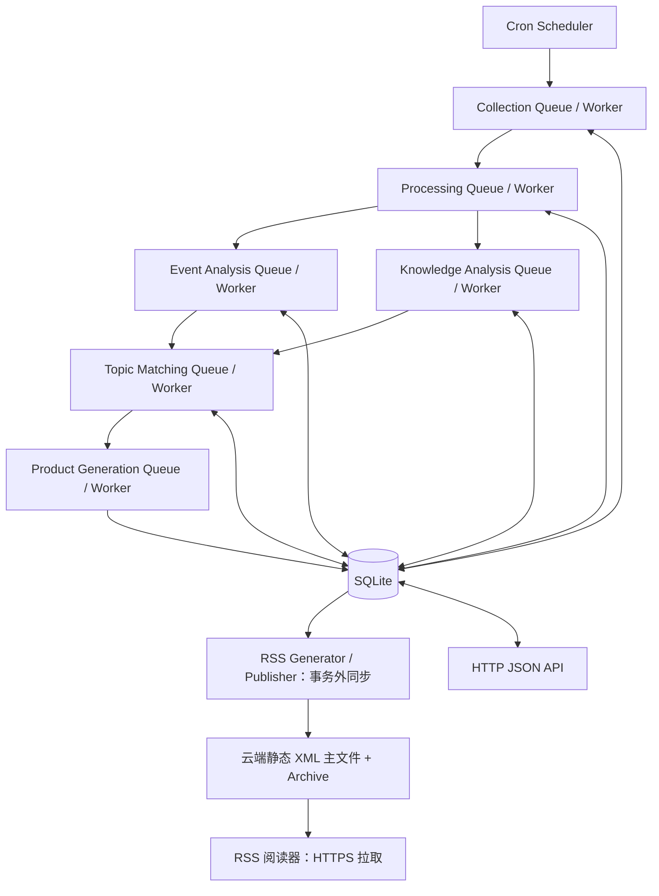

# PIS 个人情报系统 · 技术实现设计

> **版本**：v1.0 · 2026-11-14 实施前订正（既有领域/数据库契约不变）  
> **状态**：TypeScript（strict）+ Node.js LTS、Fastify、better-sqlite3（直接 SQL）、Zod、原生 fetch、Promise 有界内存队列、node-cron、Pino、PM2 已确认；SQLite FTS5 trigram/WAL/事务及相关依赖版本待在 D00/D01 实测。五个功能 Prompt、User Context 与各阶段业务流程已确认；Gitee Raw / GitHub Pages **仅为候选**，P0 API 部分协议细节仍待实施阶段定稿。  
> **本文职责**：Runtime、任务契约、LLM 输入输出、数据访问交接、静态 RSS、API、认证、失败与验收。  
> **配套文档**：[PIS_总体架构与设计原则_v1.0.md](PIS_总体架构与设计原则_v1.0.md)、[PIS_数据库设计_v1.0.md](PIS_数据库设计_v1.0.md)、[PIS_V1_开发实施计划与任务拆分_v0.1.md](PIS_V1_开发实施计划与任务拆分_v0.1.md)

## 1. 技术基线与范围

### 1.1 已确认的运行边界

- **单进程服务**：统一托管采集、分析、Published Item 生成、静态 RSS 文件生成／上传及 HTTP JSON API；八个逻辑模块不拆成微服务。RSS 文件由独立的云端静态托管提供给阅读器。
- **存储**：SQLite + WAL；11 张业务表 + 可重建的 Event FTS5 检索索引；参见《数据库设计》。
- **执行模型**：Cron Scheduler + 各阶段独立有界内存队列 + 有界 Worker。Event Analysis 和 Knowledge Analysis 均使用单 Worker；其他阶段初始也为单 Worker。
- **数据传递**：任务只包含业务 ID；Worker 加载数据库对象并返回本阶段新产生的目标 ID，Runtime 统一派发下游。
- **事务**：所有外部 HTTP/LLM 操作在写事务外；在短写事务中提交本阶段业务数据，`COMMIT` 后派发下游任务。
- **AI**：Event Analysis、Knowledge Analysis、Topic Matching 分别使用独立结构化 JSON 契约；Knowledge Prompt 分 User Context 与分析指令两部分。**V1 Product Generation 不调用 LLM**，使用模板渲染并保留可替换的 `PublicationRenderer` 接口。
- **访问**：云端静态 RSS 2.0 + `content:encoded`，PIS 保留 HTTP JSON API；单用户 API Bearer Token。RSS 只用高随机度秘密路径 URL，不做动态服务端 Feed Token 验证。
- **V1 容错**：已确认 RW-01～04：任务最多执行 2 次（包括第一次），仅技术性可重试错误；提交成功后的下游入队失败只重试派发；优雅关闭先停止新增任务，继续处理已接受链路。无持久化队列、Outbox、任务恢复、Exactly-once 或定时扫表补任务。

**已确认技术选型**：TypeScript（开启 `strict`）+ Node.js LTS；**不使用 Bun**，不采用 Kotlin/Java 作为 PIS V1 业务实现语言。Fastify、better-sqlite3 + 直接 SQL（不使用 ORM）、Zod、Node.js 原生 `fetch`、Promise/async-await 有界内存队列、node-cron、Pino、PM2 均已确认。仍待实施验证/定稿：具体 Node.js LTS 小版本及依赖版本、FTS5 trigram 与原生模块兼容、Cron 时区/表达式、LLM 供应商及适配参数、RSS 库/Article Adapter、安全阈值和生产部署细节；**不得将已确认的库重新标记为候选**。

### 1.2 TypeScript + Node.js 技术栈与选型状态

PIS V1 保持 **Node.js 单进程、SQLite 本地存储、低依赖、少抽象、易于 Coding Agent 实现与 Review** 的原则。业务领域模型、数据库 DDL、六阶段任务和 Prompt 契约不因语言确定而修改。

| 项目 | V1 技术基线 | 状态及验证要求 |
|---|---|---|
| 语言 / 类型检查 | TypeScript，`strict: true` | **已确认**；编译检查为 CI 必过 |
| 运行时 | Node.js LTS；不使用 Bun | **已确认**；锁定确切版本并记录构建方式 |
| HTTP JSON API | Fastify；**不承担静态 RSS GET** | **已确认**；验证 Bearer、Schema、分页、状态码 |
| SQLite | `better-sqlite3` + 直接 SQL、无 ORM | **已确认**；D01 对现有 DDL、FTS5 trigram、JSON、WAL、事务做真实兼容测试 |
| 结构化数据 | Zod | **已确认**；业务输入及五类 LLM JSON 输出严格校验 |
| HTTP / LLM | Node.js 原生 `fetch` + 小型统一调用包装 | **已确认方案**；供应商协议/重试/超时参数实现期配置，不新增多模型编排 |
| 六阶段 Runtime | Promise / async-await + 独立有界内存队列，初始每阶段单 Worker | **已确认**；需验证背压、结果派发与有限重试 |
| Cron | `node-cron` | **已确认**；表达式合法性及 `Asia/Shanghai` 等部署时区须实现期验证，不强制写死主机时区 |
| 日志 | Pino | **已确认**；敏感字段脱敏与运行错误留痕 |
| 进程守护 | PM2 | **已确认**；用于部署，不参与业务状态/任务持久化 |
| RSS / 页面提取库 | 选择少量适配 Node.js 的成熟依赖 | **待实现期选择**；不改变 Adapter 契约 |
| 静态 RSS Publisher | 生成本地 XML/Archive，发布适配器独立于业务 | **已确认架构**；**Gitee Raw 与 GitHub Pages 待实测后择一**，无需自有域名 |

**实施边界**：

- 开发时运行 TypeScript 工具链并开启 `strict`；生产环境使用 Node.js 运行编译产物，不引入 Bun。精确依赖版本、模块格式和包管理器由 D00 固定并提交锁文件。
- Node.js 的异步队列应明确容量、背压、关闭与派发状态；不将普通 HTTP 请求或静态 RSS 同步加入六阶段业务队列，也不额外引入 Redis、消息代理或分布式 Worker。
- 尽量用直接 SQL、明确的 DTO/Schema 和少量模块组织实现；不要因为选用 TypeScript 而改变 SQLite 11 表与已确认的 Event FTS5 模型。
- 每次 LLM 调用仍从部署目录的真实 Markdown 文件读取 Prompt，不作启动缓存或打包成不可编辑资源。
- D00/D01 优先验证现有 SQLite DDL + FTS5 trigram、WAL、JSON 和事务；RSS/正文获取、背压、优雅关闭、Prompt 热读取分别在对应小里程碑验证，避免 D00 承担全部场景。

### 1.2.1 实施阶段变更范围与未决项

- **只同步工程实现与文档状态**：不修改 Event/Knowledge/Topic/Published Item 语义、数据库 11 表及 FTS5 基线、五个 Prompt 的 JSON 契约、RSS 主文件 200 条 + 200 条封存归档规则。
- **仍待决定**：Gitee Raw / GitHub Pages 最终渠道，具体仓库/分支/部署模式与缓存时效；Source `type/url` PATCH 政策；HTTP Cursor 编码、精确错误码与筛选参数；Source Adapter 与 LLM Provider 的实际配置。上述事项应归属于对应实现任务，禁止默认视为用户已批准。
- **实施/验收关系**：具体任务边界、单任务上下文、Case ID、验收及依赖详见《PIS V1 开发实施计划与任务拆分 v0.1》。开发阶段仅以已确认的 **D00～D16（17 个里程碑、69 张任务卡）**为执行粒度；《测试用例设计》§5.3 已同步到相同编号。每张任务卡由 Worker 实现、Lead 验收、Architect 即时复核；不改变现有 Case ID 或 P0 判定标准。


### 1.2.2 已确认的开发里程碑与验收入口（2026-11-14）

本表是**工程执行索引**；69 张任务卡的具体范围、前置依赖、可修改文件边界、测试 Case ID 与 Gate **仅以** `PIS_V1_开发实施计划与任务拆分_v0.1.md` 为准，避免在本技术契约中维护第二套任务描述。所有任务初始状态为 `NOT_STARTED`。

| 里程碑 | 交付范围 | 任务数 |
|---|---|---:|
| `D00` 工程骨架 | 工程可启动、类型检查和测试脚本可执行 | 4 |
| `D01` SQLite 基础 | 11 表、FTS5 / WAL / 事务验收 | 4 |
| `D02` Prompt / LLM 基础 | Prompt 读盘、JSON Schema、Stub | 4 |
| `D03` Source / Topic 管理 | 配置管理 API | 3 |
| `D04` RSS Source Adapter | RSS 解析、正文获取和降级 | 3 |
| `D05` Collection | 新条目识别、采集持久化与检查点 | 4 |
| `D06` Processing | Content 先持久化后路由 | 4 |
| `D07` Knowledge Analysis | 价值判断与 Knowledge 独立验收 | 4 |
| `D08` Event Search | 事件全历史候选检索独立验收 | 4 |
| `D09` Event Analysis | 新事件 / 进展 / 无增量独立验收 | 5 |
| `D10` Topic Matching | 仅匹配启用 Topic，并保存关联 | 4 |
| `D11` Published Item | 模板、发布门槛、唯一快照 | 4 |
| `D12` 本地静态 RSS | 两类 Feed、200/200 归档 | 4 |
| `D13` 云端 Publisher | 静态同步及 Gitee/Pages 二选一实测 | 4 |
| `D14` Retrieval / HTTP API | 查询、Cursor、Bearer | 4 |
| `D15` 六阶段 Runtime | 有界队列、结果派发、重试、关闭 | 5 |
| `D16` 全链路验收 | E2E、P0 覆盖和真实模型语义报告 | 5 |

**执行与验收要求**：一个 Worker 一次只做一张 `Dxx-Tyy`；Lead 审查代码、类型检查和相关 P0 用例后，**每完成一张任务卡即交 Architect 复核**。D07 Knowledge、D08 Event Search、D09 Event Analysis 各自设独立 Gate；D12 只需本地静态 XML，不因 D13 云端服务商未选而阻塞。D13-T03/T04 如执行时尚未完成 Gitee Raw / GitHub Pages 实测与用户二选一，须标记为 `BLOCKED`，不得擅自选平台。

**里程碑完成不代表系统完成**：须在 D16 证明全部适用 P0 自动化、完整 E2E 与独立的 S0/S1 语义回归；不把固定 Stub 的通过率当成真实 LLM 质量。

### 1.3 逻辑组件关系



## 2. RT-01：任务契约与 Runtime

### 2.1 六类任务

| 任务                      | 输入（只传 ID）                | 正常业务结果                                      | 提交成功后的下游任务                                             |
| ----------------------- | ------------------------ | ------------------------------------------- | ------------------------------------------------------ |
| `CollectTask`           | `source_id`              | 新发现的 `source_item_ids[]`                    | 各新条目 → `ProcessTask`                                   |
| `ProcessTask`           | `source_item_id`         | 新 `content_id` + 本次路由集合                     | 依据路由 → `EventAnalysisTask` 和/或 `KnowledgeAnalysisTask` |
| `EventAnalysisTask`     | `content_id`             | 新建 `EVENT/ EVENT_UPDATE` 目标集合；也可能只有证据补充或无增量 | 对每个新目标 → `TopicMatchingTask`                           |
| `KnowledgeAnalysisTask` | `content_id`             | 新 Knowledge ID，或价值不足                        | 新 Knowledge → `TopicMatchingTask`                      |
| `TopicMatchingTask`     | `target_type, target_id` | 本次成功匹配的 Topic ID 集合，可为空                     | 至少 1 项 → `PublishTask`                                 |
| `PublishTask`           | `target_type, target_id` | 已持久化的 Published Item ID，或已发布                | 无后续六阶段任务；提交后向静态 RSS 同步器发出轻量通知（失败不重发业务发布） |

每种任务都要区分**成功有输出、成功无输出、执行失败**三种状态；没有新条目、没有事件增量、Knowledge 价值不足、不匹配 Topic 均是正常完成，不应触发重试。

### 2.2 模块之间不直接管理队列

业务模块自行读取必要对象、调用外部资源和 LLM、验证并持久化本阶段结果，返回新业务目标。**Runtime 解释结果并派发任务**，业务模块不持有其他模块的队列引用，也不在业务代码内自行管理 Worker。

例如 Event Analysis 处理一篇综合报道可返回多个新目标：

```json
{
  "new_targets": [
    {"type": "EVENT_UPDATE", "id": "update-001"},
    {"type": "EVENT", "id": "event-002"}
  ]
}
```

若一篇 Content 对某 Event 没有新的事实，只补充证据和可靠别名，则不为该 Event 生成 Topic Matching 任务。

### 2.3 Collection：采集与去重

1. 输入 Source ID；读取 Source 配置与 `last_collected_at`，同 Source 尽量避免并行采集。
2. 在事务外通过 `SourceAdapter.fetchEntries` 获取条目列表；来源支持可靠的增量语义时才用检查点缩小范围，RSS 不硬性过滤 `published_at > last_collected_at`。
3. 依据来源现有标识尽力识别新条目：**有 `external_id` 就优先按它判断；否则按 URL + 发布时间判断**；不加入“明确重新发布”判断分支，同批次也避免明显重复。
4. **仅对新条目**调用 `SourceAdapter.fetchContent(entry)`，由 Adapter 统一判断：entry 已包含完整正文时直接返回，否则尽量从原文 URL 获取正文；失败时返回 entry 已有的正文或摘要。RSS Adapter 也执行此规则。
5. 在一个短事务内保存本次新 Source Item，`raw_data` 保留 Adapter 的原文／摘要及来源信息，并推进 `last_collected_at`（默认本次采集开始时刻）；采集列表请求或数据库保存失败不推进。
6. 已提交的新 Source Item ID 交由 Runtime 派发 ProcessTask；无新增则正常结束。

单条正文抓取失败不必让整个来源采集失败；没有可用内容时仍可保留来源条目，在 Processing 判断是否足以形成 Content。来源复用既有 external_id 时实际重发可能被视为重复，V1 接受此限制。

### 2.4 Processing：不做跨 Content 去重

1. 读取 Source Item 的 `raw_data`（正文由 Collection 的 Adapter 尽力取得），**不再在 Processing 中发起原文 HTTP 请求**。
2. 若 Source Item 已有 `content_id`，直接加载这份已有 Content，跳至步骤 5；不能重新创建第二份 Content。
3. 尚无 Content 时，解析与清洗 Adapter 已提供的内容，生成 `FULL` 或 `PARTIAL` 的标准化对象；若内容不可用，正常结束并记录原因。
4. 在短事务中插入**本 Source Item 专属的新 Content**、回写其 `content_id`，提交事务。不同来源转载同一篇文章也各自创建 Content。
5. **Content 已经保存成功后，才调用 `routeContent(content)`**，得到 `EVENT`、`KNOWLEDGE`、两者或空集合。路由是本次任务结果，不创建专门数据库字段。
6. 由 Runtime 根据非空路由集合派发后续分析任务；空路由时保留 Content，正常结束。

来源发布实例的重复采集由 Collection 解决；事件事实重复由 Event Analysis 解决。Processing 不计算正文 Hash、不进行跨文章去重。

**路由失败后的重试**：Content 已 COMMIT 但 `routeContent` 失败时，Runtime 可重试同一 ProcessTask；下次读取其 `content_id` 后**复用已有 Content 并继续路由**，避免重新抓取或重复建 Content。重复派发的少量风险仍属于 V1 接受范围。进程退出在提交和派发之间仍可能漏派，不加入状态表或扫描恢复。

### 2.5 Event Analysis

- 输入 `content_id`；候选召回覆盖**全部历史 Event 和 Event Update**，综合规范 Entity 名称、已确认别名普通索引与 FTS5 聚合历史文本；时间只参与排序，不剔除旧 Event。
- 向最终判断 LLM 提供：当前 Content + 每个入选候选 Event 的基本资料（Entity、Subject、Scope、Description 等）及其**最近 10 条 Update**；取数按 `discovered_at DESC, id DESC`，可按旧→新呈现给 LLM。
- 业务结果只允许 `NEW_EVENT`、`NEW_UPDATE`、`NO_INCREMENT`；没有可识别事件事实可以返回空结果集合；一篇 Content 可以对应多个 Event 结果。
- `NEW_EVENT` 保存 Event 初始事实 + Content 证据，不另建首条 Update；`NEW_UPDATE` 保存 Update + 证据；`NO_INCREMENT` 可关联到已有 Event／Update 并补充证据、可靠别名，但**不新建 Topic Matching 任务**。
- 最终判断 LLM 直接输出 `confirmed_aliases`：Prompt 要求仅包含当前 Content 明确支持、与该 Event 核心 Entity 指向同一对象的名称；不确定时返回空数组。程序不执行第二次语义确认，也不要求 `source_excerpt`；只做格式、非空与去重，存储时保留当前 `content_id` 来源，V1 接受 LLM 语义误判风险。
- 一篇 Content 可判断涉及多个 Event。`NO_INCREMENT` 能确认原 Update 时优先关联该 Update，不能确认时只关联 Event；一个 Content 的本次结果、证据、别名及受影响 Event 的 FTS 更新在同一短事务内提交；提交后只派发真正新建的 Event 或 Update。
- 历史相关 Update 额外检索、LLM 历史摘要、动态窗口均为未来 TODO，不纳入 V1。

### 2.6 Knowledge Analysis

- 只读取本次 Content（Title、Body、Summary、Author、Published At、Completeness），**不检索既有 Knowledge**，也不对转载内容做跨文章去重。
- 一次 LLM 调用结合 User Context 判断**相对于当前用户**的阅读、学习或应用价值；Prompt 明确分为 User Context（背景／知识基础／偏好）和 Knowledge Analysis Instructions（判断流程／功能规则／输出格式），Content 是本次调用输入；有价值时输出 Title、Summary、Category?、Findings、Value。具体文本存放在 `config/prompts/knowledge-analysis.md` 与 `config/prompts/user-context.md`，管理规则见第 17 章。
- `valuable=false` 是正常结果，不建立 Knowledge；`valuable=true` 则在短事务中保存 Knowledge，`UNIQUE(content_id)` 保证一份 Content 至多一个 Knowledge。
- Finding 是 Knowledge 的内部 JSON 数组，不是独立实体，也无独立 Topic Matching 或 RSS 任务。

### 2.7 Topic Matching

- 输入 `target_type + target_id`，目标类型为 `EVENT`、`EVENT_UPDATE` 或 `KNOWLEDGE`。
- 任务开始时读取当前启用的 Topic（仅 `id/name/description`）作为本次快照；一次 LLM 调用批量匹配，空列表正常结束。运行中的 Topic 配置变更不改变已读取的本次快照。
- `EVENT_UPDATE` 单独匹配，`buildMatchingContext` 只组装其所属 Event 的基本背景、不读取历史 Update、不调用 LLM；**不继承已有 Event 的 Topic 关联**。Knowledge 匹配用已提取 Summary / Findings / Value，不再判断知识价值。
- LLM 返回 Topic ID 列表；业务层仅接受本次提供的 Topic 集合内的 ID，批量保存成功 Topic Association。
- 已有 Published Item 则直接结束；已有 Topic Association 则不重复调用 LLM，直接返回唯一 `PublishTask`；本次新匹配至少 1 项时，保存关联并返回唯一 `PublishTask`，无匹配不持久化负结果。不做相关性分数、Topic Priority 或失败结果表。
- 新建、修改、启用 Topic 只影响后续实际匹配，不重新分析历史情报。

### 2.8 Product Generation

- 输入目标引用；目标存在、**已有至少一条 Topic Association**且尚未发布才可创建 Published Item。发布时不重新匹配 Topic，也不因关联 Topic 后来被禁用而撤销本次发布。
- V1 **完全不调用 LLM**：根据 Event / Event Update / Knowledge 的已存结构化字段，采用模板生成标题、摘要和完整可读正文。保留轻量 `PublicationRenderer.render(context)` 接口，V1 只提供 `TemplatePublicationRenderer`；未来确有需要再增加 LLM 实现，**现在不实现 LLM Renderer 或 Prompt**。
- 从已存 Content、Source Item、Event 证据关联中尽量提取实际 URL；有则程序验证、去重、附加到 `body`，没有也**正常发布**。RSS 没有真实来源时可不输出 `<link>`；不得凭空生成地址。
- 在短事务内再次核验目标存在、Topic Association 及唯一性，保存不可变 Published Item；`UNIQUE(target_type,target_id)` 防重复。**COMMIT 后**按目标类型通知 RSS 同步器重建对应静态 Feed；若上传失败，原 Published Item 不回滚也不重新调用 LLM。云端 RSS GET 不访问 PIS。

### 2.9 Worker、背压与关闭

- Collection、Processing、Event Analysis、Knowledge Analysis、Topic Matching、Product Generation 分别使用独立**有界**内存队列和 Worker，初期都使用 1 个 Worker（RW-01）。
- 队列已满时使用**背压等待**，而非在正常运行中直接丢弃任务；需要允许正常停止时解除等待，避免永久阻塞关闭。
- 在一个处理阶段的 DB `COMMIT` 成功之后派发下游任务；不允许网络、LLM 调用期间持有 SQLite 写事务。
- 正常关闭先停止 Cron 和新增外部任务，**内部已接受链路仍可派发下游**；等待所有排队、执行、入队等待和有限重试结束后才关闭队列／Worker／数据库；超时则取消剩余工作并记录日志（RW-04）。强制终止或重启不保证恢复。

### 2.10 重复执行与有限重试

| 模块                 | 低成本重复保护                                                              |
| ------------------ | -------------------------------------------------------------------- |
| Collection         | 同 Source 尽可能单飞运行 + 既有 Source Item 标识判断                               |
| Processing         | 若本 Source Item 已关联 `content_id`，复用它继续 `routeContent`；不再生成第二份 Content |
| Event Analysis     | 重新查询现有 Event、最近进展，证据联合唯一；语义重复依然依赖模型判断                                |
| Knowledge Analysis | 已有该 `content_id` 的 Knowledge 时不重复生成                                  |
| Topic Matching     | Topic Association 使用联合主键，不重复保存                                       |
| Product Generation | 同一 `(target_type,target_id)` 唯一 Published Item                       |

RW-02 已确认：每个业务任务**最多执行 2 次（包含首次）**，对临时网络／服务超时、SQLite 短暂锁冲突、LLM JSON 格式无效等技术性错误有限重试；空结果、不匹配等正常业务结果不重试；非法输入和取消不重试。重复执行前**先检查是否已有结果**，不建设通用任务状态表。

**提交与派发分界（RW-03）**：若业务数据已 COMMIT，而入队临时失败，则**只在当前执行中重试尚未成功入队的下游任务**，不重做上游业务或 LLM 分析。多个下游任务彼此独立派发与记录失败；进程崩溃导致的遗漏、模型对语义重复的误判属于 V1 接受的风险，不做后台扫表恢复。

## 3. RT-02：LLM 输入输出与校验契约

### 3.1 统一边界

- 各业务能力维护自己的 Prompt 与 JSON 结构；V1 无需 Agent 多层编排或单独的审核 Agent。
- 具备结构化 JSON/Schema 输出能力的供应商优先使用原生约束；否则要求 JSON 并使用本地结构校验。
- **LLM 只返回判断与候选数据**，不执行 SQL、不生成主键 ID、不构造或覆盖实际来源 URL。
- 严格区分：`SUCCESS_WITH_OUTPUT`、`SUCCESS_EMPTY`、`FAILED` 三类任务完成语义（逻辑结果，不必持久化为一张状态表）。
- 事实依据应以当前 Content 为基础；对于来源不完整的 `PARTIAL` Content，禁止填补未读到的结论。

### 3.2 Event 检索理解（阶段 A）

在正文中识别核心 Entity、Subject、用于召回的检索词／别名候选；这些只是**本次候选搜索线索**，不能直接保存为已确认别名：

```json
{
  "entity": "星云科技",
  "subject": "反垄断监管",
  "search_terms": ["星云科技 反垄断", "Nebula Technology antitrust"]
}
```

一次检索覆盖所有已保存历史 Event；FTS5 + 实体名／别名索引组合召回，候选排序可以考虑主体、事项、语义与时间相关性。没有独立 Entity 注册表。

### 3.3 Event 归属和进展判断（阶段 B）

LLM 输入：当前 Content、候选 Event 的 `title/entity/subject/scope/description`、每个候选 Event 的**最近 10 条** Update（含标题、描述、时间）。建议在输出中仅引用候选 Event ID，不生成 Event ID。

以下 JSON 展示**结构含义**，不是直接运行的 JSON Schema：

```json
{
  "results": [
    {
      "action": "NEW_UPDATE",
      "event_id": "event-001",
      "title": "监管机构启动新的调查",
      "description": "新报道确认该监管机构已启动调查。",
      "occurred_at": null,
      "confirmed_aliases": ["Nebula Tech"]
    }
  ]
}
```

各 Action 的条件：

| action         | 结构条件                                                         | 保存行为                      |
| -------------- | ------------------------------------------------------------ | ------------------------- |
| `NEW_EVENT`    | `title`、`entity.name`、`subject`、`scope`、`description`，可选发生时间 | 业务层生成新 Event ID，保存初始事实与证据 |
| `NEW_UPDATE`   | 从候选集合中选合法 `event_id`，输出进展 Title/Description                  | 业务层生成 Update ID，保存新进展与证据  |
| `NO_INCREMENT` | 指向已有候选 `event_id`，必要时已有 `event_update_id`                    | 可增加来源证据、确认别名，不派发新情报       |

一份 Content 可涉及多个不同 Event，阶段 A 可提取多组检索线索，阶段 B 返回多项判断；没有事件事实则 `results=[]`。`confirmed_aliases` 是**LLM 已做语义确认的名称数组**：只对输入中的 Event 核心 Entity 保存有当前 Content 支撑的同一对象名称。程序不做 `source_excerpt` 原文匹配或二次别名语义审核，只校验数组类型、非空字符串并利用数据库约束去重，保存证据 `content_id`；不新增 LLM 调用。`NO_INCREMENT` 能确定具体旧 Update 时关联该 Update，否则关联 Event。同一 Content 的结果在一个短事务内保存，冲突动作在事务前拒绝。

### 3.4 Knowledge Analysis

LLM 的**业务数据输入**仅当前 Content，不查询历史 Knowledge 或 Topic；其 Prompt 必须拆为两部分：① User Context（用户背景、知识基础、兴趣和信息偏好）；② Knowledge Analysis Instructions（分析规则、职责及 JSON Schema）。单次调用完成价值判断与提取；输出有两种合法形态：

```json
{
  "valuable": true,
  "title": "通过风险分配优化商品期货策略",
  "summary": "文章讨论波动率调整和产业分类风险预算。",
  "category": "Method",
  "findings": [
    {"title": "风险集中", "description": "高波动品种可能主导组合风险。"}
  ],
  "value": "提供可进行回测检验的风险控制思路。"
}
```

```json
{"valuable": false}
```

`valuable=true` 时标题、摘要、价值说明必需且非空，`findings` 为符合结构的数组，条目数量由内容决定；Category 可为 `Insight / Experience / Method / Resource` 或空。`valuable=false` 时不创建 Knowledge；不要添加评分、阅读价值等级或历史 Knowledge 查询。

### 3.5 Topic Matching

输入目标对象 + 当前全部启用 Topic 的 `id/name/description`。Event Update 包含所属 Event 背景；Knowledge 包含 Summary、Findings、Value。模型只输出：

```json
{"matched_topic_ids": ["topic-001", "topic-003"]}
```

空数组是成功无匹配；ID 必须来自当前本次提供给模型的 Topic 集合，重复 ID 在业务层去重。不要求解释、评分或置信度。

### 3.6 分层校验与错误处理

1. **结构校验**：JSON 可解析；字段类型、必须字段、数组和枚举合法；`valuable` 可用于区分 Knowledge 成功／无结果。
2. **引用校验**：Event ID 必须是阶段 B 提供的合法候选、Topic ID 必须在当前启用集合中，且目标存在；不接收模型自造 ID。
3. **事实与语义责任**：LLM 在本次 Event 判断中负责事实依据和核心 Entity 别名的语义确认，Prompt 约束不编造原文事实或别名；应用不实现无法可靠自动化的别名语义复核，仅对返回结构、引用及基本字符串进行检查。重大事实仍按原有业务规则对待，但**V1 不新增审核 Agent**。
4. **持久化前校验**：发布源对象存在、Topic 已关联；RSS 原文链接必须来自数据库存证，绝不来自模型编造 URL。

结构或业务引用错误可以有限次重新调用；明确无价值／无增量／无 Topic 匹配不算错误。重试耗尽则记录日志，结束任务。不新增 `analysis_results`、`matching_attempts` 或失败状态表。

## 4. RT-03（静态发布部分）：云端 RSS、归档与历史补读

### 4.1 两种正式 Feed 和云端目录

| Feed | 包含业务目标 | 云端静态订阅路径 |
|---|---|---|
| **Event Updates** | 新 Event + Event Update | `/feeds/{secret}/event-updates.xml` |
| **Curated Content** | Knowledge | `/feeds/{secret}/curated-content.xml` |

- `{secret}` 是使用密码学安全随机源生成、至少 128 bit 熵的 URL 路径片段（例如 32 个十六进制字符），仅作为订阅地址的非显眼命名；静态托管端不校验 Token，不存在的文件按托管方默认逻辑返回 404。**若选用候选的公开 Git 仓库，其文件树和历史公开可见，路径无法真正保密**；不能要求平台关闭公开仓库目录列表，也不能宣称随机目录具有访问控制能力。必须 HTTPS，公开仓库只包含允许公开的 RSS 静态产物。
- 同一 RSS 订阅 URL 与 PIS 运行节点分离；**在发布渠道、仓库、分支与路径不变时**，迁移 PIS 只需重新配置 Publisher 并以 SQLite 已有数据校准云端，阅读器订阅不变。若从 Gitee Raw 切到 GitHub Pages 或反向切换，通常需要更新阅读器订阅地址（V1 不额外引入自定义域名或永久重定向服务）。托管平台、同步协议与缓存行为留待选型验证。
- 不在 PIS 中实现 `/feeds/...` 动态 GET 路由，不提供 RSS 查询 Cursor API；保留 HTTP JSON API 的独立认证与检索。V1 不按单 Topic 新建 Feed。

### 4.2 RSS 输出映射

- 格式为 RSS 2.0，`description` 作为摘要，`content:encoded` 作为独立可阅读的安全 HTML 正文。XML 特殊字符正确转义。
- `guid` 使用稳定的 `published_items.id`（例如 `pis:published:<id>`，`isPermaLink=false`），归档与滚动主文件重复出现同一 Published Item 时，GUID 完全一致。
- `pubDate` 由 SQLite `published_items.published_at`（`+08:00` ISO 8601）转换成 RSS 所需 RFC 822 风格；时间语义为首次发布，不等于来源发布时间。
- `title`、`description`、`content:encoded` 均来自数据库中保存的不可变 Published Item 快照，静态重建不能调用 LLM、改写正文或根据后来的证据重新选取链接。没有有效来源 URL 时省略 `<link>`，不能伪造原文地址。
- `category` 可取当前已保存 Topic Association 关联的名称，属于生成时的展示标签；不新增 `product_type`、RSS Item、阅读进度或回执表。静态主文件和封存归档可在不同时间生成，标签不要求倒改已封存 XML。

### 4.3 主 Feed、静态归档与历史完整性

- 每种 Feed 的主文件始终覆盖生成**最近 200 条**（默认值可配置）；它是滚动窗口，而非全部历史上限。排序按 `(published_at DESC, id DESC)`，两个 Feed 分别筛选对应类型。
- 归档采用每 Feed **固定 200 条一批的封存文件**，例如 `archive/event-updates-0001.xml`、`archive/curated-content-0001.xml`。已封存归档的文件名、条目 GUID 集合和内容均不可变；不能因新条目、后补证据、时间并列或迁移而覆盖旧归档。归档生成时以**尚未封存的 Published Item** 按首次发布顺序选择完整批次，并固定成员；封存文件本身提供可恢复的 GUID 集合与边界，不增加业务表。
- 主文件可与最新封存归档包含部分相同 GUID（例如发布第 201 条时，主文件包含第 2～201 条，而已封存 1～200 条）。**跨主文件和归档以 GUID 去重**；各归档彼此不重叠，联合所有文件能覆盖全部 Published Item。禁止为了消除主文件／归档重叠而遗漏条目。
- 每次重建生成与封存档案边界兼容的静态链：主 Feed 通过 `atom:link rel="prev-archive"` 指向最新封存档案，历史档案继续链接更旧档案，并包含规范所需的 `fh:archive` / `atom:link` 元信息。静态文件不接受 `?before=<cursor>` 读取；只提供静态 URL 以及 JSON API 的独立历史查询。
- 阅读器对 RFC 5005 归档发现与自动补读的支持并不统一。正式上线需要实测：首次订阅、超 200 条新增、归档链接、离线后补读及 GUID 去重。**不能把云端文件均可访问等同于客户端必定自动补齐所有历史。**
- 极端时间并列、时钟回拨或迟到插入也不能导致已封存档案重写。重建时以既有归档 GUID 集合为已封存边界，新增但未归档的条目排入后续归档；不能只根据当前时间排序反复重切所有旧批次。

### 4.4 静态生成与上传顺序

- Published Item 在正常业务短事务内提交后，对应 Feed 标记为需要同步；静态构建和网络上传严格在写事务外执行。不将一次上传失败视为 PublishTask 的业务失败，也不重做模板或 LLM。
- 对同一个 Feed 的生成和上传**串行化**；连续提交可合并成一次同步，但最终云端主文件必须覆盖全部已提交最新 Published Item，避免旧生成结果反向覆盖新内容。
- **先准备并验证新封存归档，再发布引用它的主 Feed**；归档只创建或存在即校验，不修改已封存 XML；主文件必须是完整合法 XML，避免读者读取到半成品。对 Git 托管，可优先在本地暂存全部修改，以**单次提交／Push（Gitee Raw）或一次完整 Pages 部署（GitHub Pages）**发布；具体缓存、上线顺序、原子可见性及远端冲突处理应在选定平台上实测，不能将 Git 提交原子性直接等同于 HTTP/CDN 端的瞬时一致性。适配器应支持列举、读取、比较和更新仓库产物，以便归档校验与迁移恢复。
- 云端读流量不会查询 SQLite 或访问 PIS，主文件需要合理的短缓存或覆盖缓存失效策略；缓存 TTL 在部署阶段根据可接受延迟确认。不得承诺读者立即看见上传后的新文件。

### 4.5 失败、恢复与同步边界

- 上传错误做轻量有限重试（例如最多 2 次含首次，遵循基础技术性错误分类）；耗尽记录失败，不回滚 Published Item，不创建持久化上传任务／Outbox／新的业务状态表。
- **进程启动时同步校准** 两个主 Feed 及现有静态归档；每次后续 Published Item 成功提交也触发增量同步。校准先读取／列举现有归档 GUID 边界以避免修改封存文件，再读取 SQLite 生成所需主 Feed 和尚未封存的批次；缺失文件重传，内容不同的已封存归档须记录冲突并人工核查，不能静默覆盖。
- 启动同步是**可重建发布投影**，不是恢复 Collection / Event 等六阶段未完成任务；不改变 RW-01～04 对业务任务异常中断的范围。迁移时保留 SQLite 和云端现存归档，可换机器重建主文件及缺失归档。
- 整体无需云端运行的 Worker、数据库或 Web API；PIS Publisher 只上传静态文件。

### 4.6 访问边界

- PIS 的 JSON API 继续使用独立 Bearer Token，不能因为知道 RSS URL 就访问 `/api/`；RSS 云端静态文件没有鉴权服务。
- 不在 RSS 正文、原始文章来源链接中主动嵌入完整订阅地址；日志中尽量不要记录完整 URL。**公开 Git 仓库会公开文件名、目录和历史版本，随机路径可被直接发现**；使用第三方云端阅读器也可能暴露 URL。只发布可公开的 RSS 产物，不上传 API Token、PIS SQLite、内部配置、Prompt 或 User Context。
- 此方案适用于来源于公开信息的个人情报；若未来需要严格保密，可另外设计 CDN 边缘鉴权，但**V1 不实现**。

### 4.7 发布渠道候选与最终决策门槛（待选型，非实现定案）

**正式候选仅有两项**；本章不预设默认服务商，也不要求双写或多平台容灾。两者无需用户自有域名，采用公开仓库承载基于公开信息生成的 RSS 文件。

| 候选 | 订阅 URL（示意，不是实际已创建地址） | PIS 上传方式 | 重点验证 |
|---|---|---|---|
| **Gitee 公共仓库 Raw 文件** | `https://gitee.com/<user>/<repo>/raw/<branch>/feeds/<secret>/event-updates.xml` | Git Push 或 Gitee 仓库文件 API；更新主文件并提交新增静态归档 | 大陆网络可达性；匿名 GET 是否为可直接解析的 RSS XML（非 HTML、登录页、附件或验证码）；HTTP 状态/MIME/跳转；缓存刷新；请求频率和仓库限制 |
| **GitHub Pages 公共仓库静态站点** | `https://<user>.github.io/<repo>/feeds/<secret>/event-updates.xml` | Git Push 触发 Pages 部署或 CI/CD 上传完整站点 | 大陆网络可达性；正式 URL 能否 HTTPS 稳定获取 XML；部署耗时／构建频次；缓存刷新；归档相对链接与 RSS 阅读器兼容 |

**统一实施约束**：

1. `Published Item`、XML Renderer、主 Feed（最新 200 条）、封存归档、GUID 均与发布渠道无关；Publisher 的输入为可部署文件集合，具体 Git/API/Pages 适配在基础设施层，不侵入 Product Generation。V1 不为了适配平台增加业务表或新的六阶段任务。
2. 每次发布先在本地生成并校验完整 XML 和归档链接，再将变化文件作为一次版本化发布候选；同一 Feed 串行，处理远端 Push 冲突或 Pages 异步部署，确保旧产物不会反向覆盖新产物。封存归档不可改写，新增主文件应在其引用的归档可读后对外可见；如托管平台存在缓存传播延迟，必须在候选环境下通过测试明确处理方式。
3. 公共仓库可浏览、克隆和搜索，路径随机值不是秘密；因资讯来源公开而接受这一公开发布边界。源码、密钥、数据库及未发布私有材料不得进入发布仓库。公开仓库不是“无法枚举目录”的私有对象存储。
4. 以实际 RSS 客户端和实际使用的中国大陆网络测试匿名订阅、中文与 `content:encoded`、XML 内容类型、更新延迟、错误页面、离线补读与 RFC 5005 归档链接，不能只根据 Git 或 Pages 文档判断可用。
5. **保留待决项**：最终选择 Gitee Raw 或 GitHub Pages、仓库／分支和部署目录、Git Push 或 API／Actions、更新合并间隔、发布缓存时效与可接受延迟。用户决定后再落实具体适配器与部署配置；切换平台时默认需要修改阅读器的 URL。

## 5. RT-03（HTTP API 部分）：HTTP JSON API

### 5.1 配置管理（模块 01，经模块 07 暴露）

| 方法      | 路径                                 | 作用                                          |
| ------- | ---------------------------------- | ------------------------------------------- |
| `GET`   | `/api/sources`、`/api/sources/{id}` | Source 列表与详情，允许查询 `last_collected_at`       |
| `POST`  | `/api/sources`                     | 创建来源                                        |
| `PATCH` | `/api/sources/{id}`                | 修改订阅来源或启停，普通配置接口不直接修改采集检查点                  |
| `GET`   | `/api/topics`、`/api/topics/{id}`   | Topic 列表与详情                                 |
| `POST`  | `/api/topics`                      | 新建 Topic                                    |
| `PATCH` | `/api/topics/{id}`                 | 修改 Topic `name/description/enabled`；不回溯已存情报 |

V1 不强制提供业务对象的物理删除接口；禁用来源/Topic 以保留已有证据与历史关联。

### 5.2 四类历史查询（模块 06，经模块 07 暴露）

| 查询领域                     | P0 最小接口                                                                                               | 返回重点                                     |
| ------------------------ | ----------------------------------------------------------------------------------------------------- | ---------------------------------------- |
| **Topic Query**          | `GET /api/topics/{id}/items`                                                                          | 已匹配 Event / Update / Knowledge 的历史关联及其目标 |
| **Event Query**          | `GET /api/events`、`GET /api/events/{id}`、`GET /api/events/{id}/updates`、`GET /api/event-updates/{id}` | 事件基础、所有历史进展、证据 Content 引用                |
| **Knowledge Query**      | `GET /api/knowledge`、`GET /api/knowledge/{id}`、`GET /api/contents/{id}`                               | 知识摘要、Findings、Value、原 Content 与来源        |
| **Published Item Query** | `GET /api/published-items`、`GET /api/published-items/{id}`                                            | 发布快照、来源目标、时间、Topic 关联                    |

列表统一以 `limit`（默认 50，最大 200）+ `cursor` 做分页，允许合理的时间和类型过滤；详情通过 Content、Source Item、证据引用追溯原始来源。P0 不扩展为复杂查询 DSL、全文搜索或语义搜索。Event Query 可以分页读取**所有历史 Update**，不受模型“最近 10 条”上下文限制。

### 5.3 JSON API 与云端 RSS 秘密路径的边界

- **JSON API**：采用单用户独立 Bearer Token，例如 `Authorization: Bearer <API_TOKEN>`；PIS 只对动态 API 验证它。
- **RSS**：云端仅按完整静态 HTTPS 路径 `/feeds/{secret}/*.xml` 返回文件；`secret` 是高随机度目录名，**不是 PIS 动态 Feed Token**，没有 Token 验证接口、轮换 API 或阅读器会话。错误路径得到云端的正常未找到响应。
- 两者互不赋权。秘密路径意外外泄后应生成新路径、重新上传静态文件、删除旧对象并更新订阅；这属于部署操作，不新增用户／凭证业务表。
- 云端不开放目录列表、公共索引或匿名对象枚举；尽量关闭完整 URL 访问日志和第三方追踪。严格使用 HTTPS；阅读器云同步服务可能获得完整秘密链接。

## 6. 数据库衔接与简化原则

| 模块阶段               | 短事务写入                                               | 事务外处理                                           |
| ------------------ | --------------------------------------------------- | ----------------------------------------------- |
| Collection         | 新 Source Item（含 Adapter 获取的 `raw_data`）+ Source 检查点 | Adapter 获取来源条目和尽力提取原文、来源条目尽力去重                  |
| Processing         | 新 Content + 当前 Source Item 的 `content_id`           | 解析与清洗、**COMMIT 后** `routeContent`；不进行原文 HTTP 抓取 |
| Event Analysis     | Event 或 Update、证据链接、可靠 Entity 别名、相关 FTS 行           | 全历史候选检索、LLM 判断                                  |
| Knowledge Analysis | Knowledge                                           | LLM 价值分析                                        |
| Topic Matching     | 成功的 Topic Association                               | LLM Topic 匹配                                    |
| Product Generation | 唯一 Published Item                                   | 模板 Renderer 生成正文，无 LLM；来源 URL 可选、有则校验并附加        |

普通外键、组合唯一约束、合规枚举在 SQLite 实施；`target_type + target_id` 的多态目标存在性、Topic 发布门槛及原始链接可靠性由应用在同一短事务或提交前核验。时间均统一成 `+08:00` ISO 8601 字符串写入库。连接参数及完整 DDL 见《数据库设计》。

## 7. 技术设计总复核

### 7.1 交叉一致性审查

| 审查点              | 复核结论                                                                                                                       |
| ---------------- | -------------------------------------------------------------------------------------------------------------------------- |
| 来源去重与 Content 去重 | Collection 由 Adapter 尽力取得原文后保存 Source Item；Processing 不做 HTTP 原文补全或跨 Content 去重，先提交 Content 再路由；Source Item→Content 成功后一对一 |
| 双路径分析            | 同一 Content 可同时产生 Event / Knowledge 情报，两个分析队列独立执行；某一条失败不阻止另一条                                                               |
| Event 归属         | Event 全历史召回；最终 LLM 只看到候选 Event + 最近 10 条 Update；语义缺失风险已列未来 TODO                                                            |
| 无增量进展            | 重复报道可补原始证据及已确认 Entity 别名，但不创建新 Published Item                                                                              |
| Topic 与 RSS      | Topic 关联只在后续实际 Matching 时生成；RSS 历史归档只读取过去已发布记录，不回溯历史 Topic                                                                 |
| 发布身份             | 多 Topic 可以关联同一目标，但一个 `(target_type,target_id)` 只生成一个 Published Item；GUID 稳定                                                |
| 来源核验             | 原文 URL 是可选信息；有则由程序提取并校验，无则仍可发布；不能臆造链接，快照不因新证据自动改写                                                                          |
| 任务派发             | RW-01～04 已确认：结果驱动派发、业务重试与入队重试分离、有界背压、尽力排空后关闭；COMMIT 后崩溃可能漏派                                                                |
| Feed 历史          | 200 是云端主文件滚动窗口上限而非历史上限；按批封存静态档案且 URI 内容不可变；客户端自动补读需测试                                                                                    |
| 身份与权限            | API 使用 Bearer Token；RSS 仅用高随机秘密路径，不做动态 Token 校验；无需登录/多用户模型                                                                                          |

### 7.2 已明确、无需提前扩展的非目标

- 不增加 Outbox、事务消息、持久化恢复状态、任务执行历史表或单独的重启恢复模块。
- 不增加跨 Content 的哈希／SimHash／Embedding／LLM 去重系统。
- 不增加 Knowledge 历史语义归并、Topic Priority、匹配评分、独立重大事件告警或日报产品。
- 不增加持久化 Event 历史摘要；Event V1 使用基本信息 + 最近 10 条 Update。
- 不在 RSS Feed 上实现 per-reader 已读或拉取游标保存，不要求邮件、IM 推送。云端上传是静态文件发布，不是向阅读器逐一推送。

### 7.3 实施前应验证的技术细节（不是新增业务需求）

1. **RSS 归档稳定性**：云端静态归档文件封存后 URI 与 XML 内容均不变；新消息、等时刻发布时间与时钟异常不应造成遗漏或重写。针对所选 RSS 阅读器验证自动历史补读支持情况，不保证所有客户端都支持。
2. **LLM 结构约束**：具体模型供应商能否原生使用 JSON Schema；不支持时使用严格解析，重试不能造成重复写入。
3. **Cron 时间语义**：明确 Cron 方言及其采用的时区，与数据库统一 `+08:00` 记录的时间含义一致，但不把 Cron 语法写入领域模型。
4. **SQLite 部署能力**：核实实际 SQLite 构建含 FTS5 trigram 和 JSON 函数，确认索引重建、写锁与连接配置。
5. **关闭与背压**：有界队列满时的等待和系统优雅停机需覆盖测试，以避免 Worker 永久等待。
6. **任务提交边界**：对每阶段测试事务失败不推进、提交后派发失败只重试下游入队以及崩溃窗口的已接受行为。
7. **来源获取安全**：Source URL/原文 URL 的 HTTP 超时、重定向、最大正文尺寸、可接受 MIME 类型及安全的网络访问边界，应在实际 HTTP 客户端实现时配置。

## 8. V1 端到端验收范围

| 场景           | 必须看到的行为                                                            |
| ------------ | ------------------------------------------------------------------ |
| 新事件          | 新 Source Item → 新 Content → 新 Event → Topic 匹配 → Event Updates RSS |
| 已有 Event 新进展 | 新 Content → 旧 Event 新 Update → 新 RSS 条目                            |
| 跨源重复报道       | 各自保留 Content → 旧 Event 无增量 → 补证据、不新发 Event Updates                 |
| 技术好文         | Content → 有效 Knowledge → 匹配 Topic → Curated Content RSS            |
| 无价值内容        | 不保存 Knowledge、不发 Curated Content                                   |
| 未匹配 Topic    | 资产保留，但不产生 Published Item                                           |
| 一文两用         | 同一 Content 可分别走 Event / Knowledge 并产生不同 Published Item             |
| 新建 Topic     | 不回溯旧情报；后续新 Update 独立匹配                                             |
| RSS 大量积压     | 云端主 Feed 最近 200 条与封存静态归档联合覆盖全部历史；阅读器自动补读须实际验证                 |
| 访问边界         | 错误／不存在的秘密 URL 路径不能找到 RSS 文件，云端无动态鉴权；API Bearer Token 仍独立生效     |
| 失败与重放        | DB 事务正确回滚，既有 Source Item/Knowledge/Published Item 防重复；程序重启不承诺队列恢复  |

## 9. 流程伪代码复核进度

业务流程按下列顺序逐段复核，目标是确认前置查询、条件分支、LLM 输入输出、写入范围与派发结果：

1. Scheduler / Collection：**已完成伪代码复核**；来源检查点、简单重复条目判断、Adapter 全文获取与回退、失败不推进。
2. Processing：**已完成伪代码复核**；消费 Adapter 已取得内容、Content 一对一持久化、COMMIT 后路由及重试。
3. Event Analysis：**已完成伪代码复核**；多组线索 → 全历史候选召回 → 最近 10 条上下文 → 三种 Action → LLM 直接确认别名 → 证据和 FTS 同事务保存。
4. Knowledge Analysis：**已完成伪代码复核**；单次 LLM、用户上下文与分析指令分开、有效结果写一份 Knowledge。
5. Topic Matching：**已完成伪代码复核**；三类目标上下文、Topic 快照、单次批量 LLM、已关联时复用。
6. Product Generation：**已完成伪代码复核**；模板 Renderer、不调用 LLM、可选来源链接、不可变快照与唯一发布。
7. RSS：已确认云端静态 XML、秘密路径、主文件 200 条窗口、不可变归档及启动同步；旧动态 GET、Feed Token 校验和 `?before=cursor` 设计已废止。P0 API 已讨论接口细节，其中新增限制不擅自视为确认。
8. Runtime：**已完成伪代码复核 RW-01～04**；短事务、两类重试分离、队列背压、尽力排空、可接受的崩溃窗口。

**Collection、Processing、Event Analysis、Knowledge Analysis、Topic Matching、Product Generation 与 Runtime** 的关键流程均已逐段确认；五个功能 Prompt、独立 User Context 及管理决策也已完成复核（见第 17 章）。

## 10. 已确认流程伪代码：Collection → Processing

> 本节保留 2026-11-12 已确认的 Collection → Processing 业务契约；下面统一采用 **TypeScript 风格业务伪代码**。省略的仓储方法、错误类型、DTO 由实现任务定义，并非一套必须逐字照搬的框架接口。沿用六种任务及单进程内存队列，不新增数据库表。Event Analysis 见第 11 章。

### 10.1 Source Adapter：统一尽力获取正文

```ts
interface SourceAdapter {
  fetchEntries(source: Source, lastCollectedAt: string | null): Promise<SourceEntry[]>;
  fetchContent(entry: SourceEntry): Promise<SourceContent>;
}

// 例如：RSS Adapter 自行决定是否抓取网页；不是所有 Adapter 都必须抓网页。
async function fetchRssContent(entry: SourceEntry): Promise<SourceContent> {
  if (containsUsableFullBody(entry)) return fromEntryFullBody(entry);
  const fetched = await tryFetchOriginalArticle(entry.url); // 失败返回无正文结果
  if (hasUsableBody(fetched)) return fromFetchedBody(entry, fetched);
  return fromExistingEntryData(entry); // 保留 RSS 中已有摘要／正文
}
```

- `fetchContent(entry)` **始终由 Adapter 自己判断是否已有正文及是否需要额外获取**，目标是尽量获得可用正文并返回。即使其他类型 Adapter 直接从 API 获取全文，也遵循相同对外契约。
- 调用时机：仅针对 Collection 识别出的新 Source Item；不要对已采集条目反复抓取原文。
- Content 的 `FULL` / `PARTIAL` 由 Processing 根据 Adapter 实际返回内容判定。`raw_data` 可用 JSON TEXT 序列化来源记录及抓取结果；需遵守实际 HTTP 最大正文尺寸等安全限制。

### 10.2 Collection 伪代码

```ts
async function collect(sourceId: string): Promise<CollectResult> {
  const source = sources.get(sourceId);
  if (!source?.enabled) return { newSourceItemIds: [] };
  return singleFlightBySource(sourceId, async () => {
    const startedAt = clock.now();
    const adapter = adapters.get(source.type);
    const entries = await adapter.fetchEntries(source, source.lastCollectedAt);
    const candidates = deduplicateWithinBatch(entries)
      .filter((entry) => !isCollected(sourceId, entry));
    const drafts: SourceItemDraft[] = [];
    for (const entry of candidates) {
      if (!hasUsableSourceMetadata(entry)) {
        logger.warn('invalid source entry');
        continue;
      }
      const raw = await adapter.fetchContent(entry); // 全文获取在写事务外
      drafts.push(sourceItemDraft(source, entry, raw));
    }
    const newSourceItemIds = db.transaction(() => {
      const fresh = recheckUncollectedEntries(sourceId, drafts);
      const ids = fresh.map((draft) => sourceItems.insert(draft));
      sources.updateLastCollectedAt(sourceId, startedAt);
      return ids;
    });
    return { newSourceItemIds };
  });
}

function isCollected(sourceId: string, entry: SourceEntry): boolean {
  if (entry.externalId != null) {
    return sourceItems.existsByExternalId(sourceId, entry.externalId);
  }
  if (entry.url != null) {
    return sourceItems.existsByUrlAndPublishedAt(sourceId, entry.url, entry.publishedAt);
  }
  return false; // V1 对缺乏标识的条目接受少量重复
}
```

整个来源获取失败或写入事务失败则不推进 `last_collected_at`；单条抓取失败且能回退已有来源内容时仍可保存 Source Item。默认检查点采用本次采集**开始**时间；来源确有可靠增量游标时按来源真实语义使用。此处的 Source Item 去重是尽力而为，不承诺检测同 GUID 重发。

### 10.3 Processing 伪代码

```ts
async function process(sourceItemId: string): Promise<ProcessResult> {
  const item = sourceItems.get(sourceItemId);
  if (!item) return { routes: [], contentId: null };

  // 已有 Content 时跳过创建，但必须继续执行 routeContent。
  let content = item.contentId ? contents.get(item.contentId) : null;
  if (!content) {
    const normalized = normalizeContent(item.rawData, item);
    if (!normalized.isUsable) return { routes: [], contentId: null };
    content = db.transaction(() => {
      const latest = sourceItems.get(sourceItemId);
      if (latest?.contentId) return contents.require(latest.contentId);
      const created = contents.insert(fromNormalized(normalized, clock.now()));
      sourceItems.setContentId(sourceItemId, created.id);
      return created;
    });
  }
  const routes = await routeContent(content); // Content COMMIT 后调用 P-01
  return { contentId: content.id, routes };
}
```

`routeContent` 是本次 ProcessTask 的返回结果，不单独持久化；如果路由为空，已经保存的有效 Content 继续保留。如果路由失败并重试，读取已有 Content 后再次尝试；不因为路由失败而回滚已保存的 Content。由于 V1 不使用持久化队列，进程在提交后异常退出仍可能漏派。

### 10.4 Runtime 派发及验收

```ts
async function dispatchCollect(result: CollectResult): Promise<void> {
  for (const id of result.newSourceItemIds) await runtime.submit({ type: 'ProcessTask', sourceItemId: id });
}
async function dispatchProcess(result: ProcessResult): Promise<void> {
  if (!result.contentId) return;
  if (result.routes.includes('EVENT')) await runtime.submit({ type: 'EventAnalysisTask', contentId: result.contentId });
  if (result.routes.includes('KNOWLEDGE')) await runtime.submit({ type: 'KnowledgeAnalysisTask', contentId: result.contentId });
}
```

- 验证 Adapter 已含全文 → 直接使用；不含全文 → 尝试原文 URL；原文抓取失败 → 保留来源摘要／已有正文；Processing 无出站抓取。
- 验证同条 Source Item 重复处理不创建多个 Content，且 **Content 已保存但路由首次失败 → 重试仍能完成路由**。
- 验证 Collection 采集请求／事务失败不推进检查点，成功保存新 Source Item 后才派发 ProcessTask。
- 验证无可用正文 → 不创建无效 Content；可用部分正文 → `PARTIAL`；路由为空 → 保留 Content 且不派发分析任务。

---

## 11. 已确认流程伪代码：Event Analysis

> 本节沿用 2026-11-12 已复核的业务分支与交接契约，示例统一为 **TypeScript 风格业务伪代码**，不是可直接编译的完整程序；不额外引入数据库字段或任务状态。`confirmed_aliases` 已替代旧 `alias_candidates`/`source_excerpt` 设计。

### 11.1 候选召回：一篇 Content 可涉及多个信息主线

```ts
async function analyzeEvent(contentId: string): Promise<EventAnalysisResult> {
  const content = contents.get(contentId);
  if (!content) return { newTargets: [] };

  const clues = await llm.extractEventClues(content); // P-02：只提检索线索
  if (clues.length === 0) return { newTargets: [] };
  // 全历史的 Entity / Alias / FTS5 检索，之后才限制 LLM 候选数。
  const candidates = distinctEvents(eventSearch.findCandidates(clues))
    .sort(byRelevance).slice(0, MAX_CANDIDATES);
  const contexts = candidates.map((event) => ({
    event,
    updates: eventUpdates.findLatest(event.id, 10, 'discovered_at DESC, id DESC').reverse(),
  }));

  const decisions = await llm.judgeEventChanges(content, contexts); // P-03
  validateEventDecisions(decisions, contexts);
  if (decisions.length === 0) return { newTargets: [] };
  const newTargets = db.transaction(() => persistEventDecisions(content, decisions));
  return { newTargets };
}
```

- `MAX_CANDIDATES` 只限制提供给最终 LLM 的候选数量，不限制历史 Event 被检索的范围。无候选时仍可判断新 Event。
- `validateEventDecisions` 检查 Action 枚举、必填字段、已有 Event ID 属于当前候选、Update ID 存在且归属正确；同一 Content 对同一 Event 不接受相互矛盾的 Action。语义判断由 LLM 完成，结构/引用由程序校验。
- 一个 Content 对同一 Event 通常只创建一次新 Update；对不同 Event 可分别创建/更新。

### 11.2 落库：新 Event、新进展、重复报道

```ts
function persistEventDecisions(content: Content, decisions: EventDecision[]): Target[] {
  // 由外层同一个 SQLite 短写事务调用；此处不进行 await / HTTP / LLM。
  const targets: Target[] = [];
  const affectedEventIds = new Set<string>();
  for (const decision of decisions) {
    let eventId: string;
    switch (decision.action) {
      case 'NEW_EVENT': {
        const event = events.insertNew(decision, clock.now());
        evidence.insertIfAbsent('EVENT', event.id, content.id);
        targets.push({ type: 'EVENT', id: event.id });
        affectedEventIds.add(event.id);
        eventId = event.id;
        break;
      }
      case 'NEW_UPDATE': {
        const event = events.requireCandidate(decision.eventId);
        const existing = eventUpdates.findByEventAndEvidence(event.id, content.id);
        if (!existing) {
          const update = eventUpdates.insertNew(event.id, decision, clock.now());
          evidence.insertIfAbsent('EVENT_UPDATE', update.id, content.id);
          targets.push({ type: 'EVENT_UPDATE', id: update.id });
          affectedEventIds.add(event.id);
        } else {
          evidence.insertIfAbsent('EVENT_UPDATE', existing.id, content.id);
        }
        eventId = event.id;
        break;
      }
      case 'NO_INCREMENT': {
        const event = events.requireCandidate(decision.eventId);
        const update = decision.eventUpdateId
          ? eventUpdates.requireBelongsTo(decision.eventUpdateId, event.id) : null;
        if (update) evidence.insertIfAbsent('EVENT_UPDATE', update.id, content.id);
        else evidence.insertIfAbsent('EVENT', event.id, content.id);
        eventId = event.id;
        break;
      }
    }
    // P-03 已确认别名的语义；程序只做基本规范化和去重。
    for (const alias of new Set(decision.confirmedAliases.map((a) => a.trim()).filter(Boolean))) {
      if (eventAliases.insertIfAbsent(eventId, alias, content.id)) {
        affectedEventIds.add(eventId);
      }
    }
  }
  for (const id of affectedEventIds) eventSearch.rebuildOne(id);
  return distinctTargets(targets);
}
```

上述 `findByEventAndEvidence` 是根据 `event_updates` 与 `event_content_links` 的现有关系查询，不需要新增任务状态表、关联字段或数据库索引；只减少明显重复，不能保证语义级严格幂等。所有 LLM 调用及候选搜索在写事务外；保存新 Event/Update、来源证据、别名与 FTS 在**同一个短事务**中完成。LLM 返回的 `confirmed_aliases` 使用本 Content 的 `content_id` 保存来源；不再检查 `source_excerpt` 是否出现，不实现规则式 `hasExplicitAliasRelation()`，也不调用审核 LLM。

### 11.3 LLM 结果与派发

```json
{
  "results": [
    {
      "action": "NEW_UPDATE",
      "event_id": "event-001",
      "title": "监管机构启动新的调查",
      "description": "文章报告监管机构启动新调查。",
      "occurred_at": null,
      "confirmed_aliases": ["Nebula Tech"]
    },
    {
      "action": "NO_INCREMENT",
      "event_id": "event-002",
      "event_update_id": null,
      "confirmed_aliases": []
    }
  ]
}
```

- `NEW_EVENT` 创建 Event 初始事实和证据，不额外创建首条 Update；`NEW_UPDATE` 创建进展与证据；`NO_INCREMENT` 只补充证据/别名，无新情报。
- `confirmed_aliases` 在三类 Action 中都允许。LLM Prompt 必须保守确认；不确定返回 `[]`。别名若是 LLM 误判，V1 接受对应检索污染风险，但不做无法可靠编码的二次语义规则。
- LLM 不生成 Event/Update 主键，也不创造来源 URL。校验非法候选引用、重复/矛盾 Action、非法字段时有限重试。
- 事务 **COMMIT 后**，Runtime 只对返回的 `newTargets` 派发 `TopicMatchingTask(targetType,targetId)`；空结果是正常完成。COMMIT 和入队之间崩溃可能漏派，沿用 V1 已接受的轻量容错。

### 11.4 测试与复核清单

- [ ] 新 Content 完全找不到候选 Event：可创建 Event，且无初始 Update。
- [ ] 旧 Event 多年未更新：仍能经全历史 FTS/Entity 检索召回；最终 LLM 只看到该 Event 最近 10 条 Update。
- [ ] 一篇 Content 同时涉及两个独立 Event：产生两个合法 Action，结果同事务落库。
- [ ] 重复报道可确认旧 Update：关联该 Update；不能确认旧 Update：关联 Event；两者均不产生新 RSS 候选。
- [ ] LLM 返回 `confirmed_aliases`：合法非空别名去重并保存 `content_id`，不运行二次语义确认；重复报道也可补别名、刷新 FTS。
- [ ] 同一 Event 同一 Content 重试：优先复用已关联的进展；矛盾 Action 不写入；FTS 索引随写事务刷新。
- [ ] 事务失败全部回滚；COMMIT 后下游派发仅包含新的 Event 或 Update。

---

## 12. 已确认流程伪代码：Knowledge Analysis（KA-01～04）

> KA-01～03 已确认；KA-04 明确单次 LLM Prompt 分为 User Context 与 Knowledge Analysis 功能指令。Prompt 具体文本与调用管理已在第 17 章及 `config/prompts/` 定稿。

### 12.1 分析与写入

```ts
async function analyzeKnowledge(contentId: string): Promise<KnowledgeAnalysisResult> {
  const content = contents.get(contentId);
  if (!content || knowledge.existsByContentId(contentId)) return { knowledgeId: null };

  const decision = await llm.analyzeKnowledge({
    userContext: await prompts.loadUserContext(),
    instructions: await prompts.loadKnowledgeInstructions(),
    content,
  });
  validateKnowledgeDecision(decision); // 包含 valuable=false 严格结构分支
  if (!decision.valuable) return { knowledgeId: null };

  const knowledgeId = db.transaction(() => {
    if (knowledge.existsByContentId(contentId)) return null;
    return knowledge.insert(fromKnowledgeDecision(newId(), contentId, decision)).id;
  });
  return { knowledgeId };
}
```

- `valuable=false` 正常结束，不存“无价值”状态；同一 Content 至多一份 Knowledge，Findings 仅在 `findings_json` 内部保存。
- 只分析当前 Content，不查询历史 Knowledge，不以 Topic 进行价值过滤；`PARTIAL` 只能以实际已有正文为依据。跨领域高价值文章可保留。
- Runtime 在成功新建 Knowledge 后返回并派发一条 `TopicMatchingTask(KNOWLEDGE, knowledgeId)`；异常按 RW-02 有限重试。

## 13. 已确认流程伪代码：Topic Matching（TM-01～03）

### 13.1 构造目标上下文

```ts
function buildMatchingContext(target: IntelligenceTarget): MatchingContext {
  switch (target.type) {
    case 'EVENT': return contextFromEvent(target);
    case 'EVENT_UPDATE': return contextFromUpdateAndParentEvent(target);
    case 'KNOWLEDGE': return contextFromKnowledge(target);
  }
}
```

这是 DTO 字段组装，不是新的分析服务，也不调用 LLM；Event Update 不加载父 Event 的全部历史 Update。

### 13.2 匹配、事务与派发

```ts
async function matchTopics(type: TargetType, id: string): Promise<TopicMatchingResult> {
  const target = targets.get(type, id);
  if (!target) throw new InvalidTargetError();
  if (publishedItems.exists(type, id)) return { shouldPublish: false, type, id };
  if (topicAssociations.existsForTarget(type, id)) return { shouldPublish: true, type, id };

  const enabledTopics = topicsRepository.findEnabled(); // 本次执行快照
  if (enabledTopics.length === 0) return { shouldPublish: false, type, id };
  const response = await llm.matchTopics(buildMatchingContext(target), enabledTopics);
  const matchedIds = validateAndDistinctTopicIds(
    response.matchedTopicIds, new Set(enabledTopics.map((topic) => topic.id))
  );
  if (matchedIds.length === 0) return { shouldPublish: false, type, id };

  db.transaction(() => {
    targets.requireExists(type, id);
    if (!topicAssociations.existsForTarget(type, id)) {
      for (const topicId of matchedIds) {
        topicAssociations.insertIfAbsent(topicId, type, id, clock.now());
      }
    }
  });
  return { shouldPublish: true, type, id }; // 下游仅派发一次 PublishTask
}
```

- 一次 LLM 调用批量判断全部启用 Topic，只输出合法 ID 集合；不打分、不保存失败匹配、不自动继承 Event 的 Topic 关联。
- `matched_topic_ids=[]` 是成功空结果。一个目标关联多个 Topic，也**只返回一条** `PublishTask(type,id)`；由 Runtime 在事务提交后派发。
- 已存在 Topic Association 时不因 Topic 随后禁用而删除历史关联，重试时可复用已有结果。

## 14. 已确认流程伪代码：Product Generation → Published Item → RSS（PG-01～05）

### 14.1 V1 模板渲染扩展点

```ts
interface PublicationRenderer {
  render(context: PublicationContext): PublicationDraft;
}
class TemplatePublicationRenderer implements PublicationRenderer {
  render(context: PublicationContext): PublicationDraft {
    switch (context.targetType) {
      case 'EVENT': return renderEventTemplate(context);
      case 'EVENT_UPDATE': return renderEventUpdateTemplate(context);
      case 'KNOWLEDGE': return renderKnowledgeTemplate(context);
    }
  }
}
```

V1 只实现模板 Renderer，**不进行 LLM 调用**；接口用于未来可选替换为 LLM Renderer，不在本版预先实现模型、Prompt 或业务状态。

### 14.2 唯一 Published Item 保存

```ts
function publish(type: TargetType, id: string): PublishResult {
  const previous = publishedItems.find(type, id);
  if (previous) return { publishedItemId: previous.id, alreadyPublished: true };
  const target = targets.get(type, id);
  if (!target || !topicAssociations.existsForTarget(type, id)) return { publishedItemId: null };

  const context = buildPublicationContext(target);
  const links = distinctValidHttpLinks(context.sourceLinks);
  const draft = publicationRenderer.render(context); // V1 模板渲染，无 LLM
  const body = appendSourceLinksIfAny(draft.body, links);
  validatePublicationText(draft.title, draft.summary, body);

  const publishedItemId = db.transaction(() => {
    const existing = publishedItems.find(type, id);
    if (existing) return existing.id;
    targets.requireExists(type, id);
    topicAssociations.requireAny(type, id);
    return publishedItems.insert({
      id: newId(), targetType: type, targetId: id,
      title: draft.title, summary: draft.summary,
      body, publishedAt: clock.now(),
    }).id;
  });
  return { publishedItemId, alreadyPublished: false };
}
```

- 目标必须存在且已经拥有至少一个 Topic Association；发布时不重新判断 Topic，也不因其后续被禁用而重置关联。
- `sourceLinks` **可以为空**：缺失真实 URL 不阻止发布。若有链接仅由程序附加，严禁虚构来源。
- `UNIQUE(target_type,target_id)` 保证正常业务下同一目标只有一份发布快照；提交后内容长期稳定。

### 14.3 静态 RSS 发布与归档（取代旧 `readFeed` 动态接口）

以下 TypeScript 伪代码只展示“列举／读取／暂存或写入产物”的逻辑边界，不锁定发布平台；对于 Git 发布适配器，可把多次 `put` 暂存为**一次 Git 提交／站点部署**，由适配器负责最终发布，不能逐文件直接暴露不完整归档链：

```ts
interface RssArtifactStore {
  list(prefix: string): Promise<string[]>;
  read(key: string): Promise<Uint8Array | null>;
  put(key: string, xml: Uint8Array, options?: { onlyIfAbsent?: boolean }): Promise<void>;
  publish(): Promise<void>; // 将全部暂存文件作为一次完整版本发布
}

async function syncFeed(feed: FeedType): Promise<void> {
  // 同一 feed 单飞串行；按 target_type 读取 SQLite 已提交的 Published Item。
  const published = publishedItems.findAllForFeed(feed);
  const archived = await readSealedArchiveGuidSets(feed); // 从云端归档 XML 恢复边界
  const newArchives = buildCompleteBatchesOf200NotYetArchived(published, archived);
  for (const archive of newArchives) {
    await artifactStore.put(archive.key, renderArchiveXml(archive), {onlyIfAbsent: true});
  }
  const head = renderHeadXml(published.slice(0, 200), newestArchiveLink(feed));
  await artifactStore.put(feedKey(feed), head); // 主 Feed 最后暂存
  await artifactStore.publish(); // Git 一次 commit/push，或 Pages 一次完整部署
}

function onPublishedItemCommitted(targetType: TargetType): void {
  scheduleCoalescedRssSync(feedForTargetType(targetType));
  // 失败单独记录并轻量重试；不重跑 PublishTask、模板或 LLM。
}

async function onProcessStartup(): Promise<void> {
  await syncFeed('EVENT_UPDATES');
  await syncFeed('CURATED_CONTENT');
}
```

- `findAllForFeed` 需要按 `(published_at DESC,id DESC)` 稳定读取；archive 构建须排除已封存 GUID，并保持每个固定批次的成员不可变。**重建旧归档不得覆盖内容不同的同名归档**。
- `renderHeadXml` 需把已存在归档文件链接进 RFC 5005 归档链，归档链之间按封存批次链接。主 Feed 与最新封存归档的 GUID 允许重叠，跨文件阅读需按 GUID 去重。
- `scheduleCoalescedRssSync` 是同一进程中的轻量文件同步通知，**不是第七个业务阶段或持久化队列**；成功提交后出错只影响云端可见性。系统启动同步及下一次成功发布可以恢复。
- 主 Feed 与 Archive 的 GET 均由云端静态托管完成；PIS 不实现 RSS 读取路由／Feed Token 校验／`?before` Cursor。API 自身的 `cursor` 仍保留，二者不混淆。
- 当前 `RssArtifactStore` 只表示能力边界，`put` 为暂存、`publish` 为完整版本的发布意图；所选平台实际对 HTTP 读者的可见性与缓存传播必须实测。用户尚未选择 Gitee 或 GitHub Pages。

## 15. 已确认流程伪代码：Runtime（RW-01～04）

### 15.1 任务解释与下游映射

```ts
async function executeTask(task: Task): Promise<TaskResult> {
  switch (task.type) {
    case 'CollectTask': return collection.collect(task.sourceId);
    case 'ProcessTask': return processing.process(task.sourceItemId);
    case 'EventAnalysisTask': return eventAnalysis.analyze(task.contentId);
    case 'KnowledgeAnalysisTask': return knowledgeAnalysis.analyze(task.contentId);
    case 'TopicMatchingTask': return topicMatching.match(task.targetType, task.targetId);
    case 'PublishTask': return productGeneration.publish(task.targetType, task.targetId);
  }
}

function nextTasks(task: Task, result: TaskResult): Task[] {
  // 下列分支由各 task/result 对应的联合类型约束；只解释结果，不查业务数据。
  switch (task.type) {
    case 'CollectTask': return result.newSourceItemIds.map((id) => ({ type: 'ProcessTask', sourceItemId: id }));
    case 'ProcessTask': return result.contentId ? result.routes.map((route) => ({
      type: route === 'EVENT' ? 'EventAnalysisTask' : 'KnowledgeAnalysisTask', contentId: result.contentId,
    })) : [];
    case 'EventAnalysisTask': return result.newTargets.map((target) => ({
      type: 'TopicMatchingTask', targetType: target.type, targetId: target.id,
    }));
    case 'KnowledgeAnalysisTask': return result.knowledgeId
      ? [{ type: 'TopicMatchingTask', targetType: 'KNOWLEDGE', targetId: result.knowledgeId }] : [];
    case 'TopicMatchingTask': return result.shouldPublish
      ? [{ type: 'PublishTask', targetType: task.targetType, targetId: task.targetId }] : [];
    case 'PublishTask': return [];
  }
}
```

Runtime 不执行任何业务判断、LLM 或业务表写入，仅调用业务模块，解析结构化业务结果并派发下游任务。**PublishTask 成功提交后的静态 RSS 同步通知**由发布出口触发，不新增六阶段业务任务；外部 API HTTP 请求和云端 RSS GET 均不进入六种异步处理队列。

### 15.2 Worker：执行与派发重试严格分离

```ts
async function workerLoop(queue: TaskQueue): Promise<void> {
  for await (const task of queue) {
    try {
      // 第一阶段：业务执行（最多两次技术性尝试）。
      const result = await executeWithRetry(task);
      const downstream = nextTasks(task, result);
      // 第二阶段：只重试尚未成功入队的子任务，绝不重跑已提交业务。
      for (const child of downstream) {
        try {
          await submitDownstreamWithRetry(child);
        } catch (error) {
          if (isCancellation(error)) throw error;
          logDispatchFailure(task, child, error);
        }
      }
    } catch (error) {
      if (isCancellation(error)) throw error;
      logTaskFailure(task, error);
    } finally {
      markTaskFinished(task);
    }
  }
}

async function executeWithRetry(task: Task): Promise<TaskResult> {
  for (let attempt = 1; attempt <= 2; attempt++) {
    try { return await executeTask(task); }
    catch (error) {
      if (isCancellation(error) || !isRetryableTechnicalError(error) || attempt === 2) throw error;
      logRetry(task, attempt, error);
      await delay(shortBackoff(attempt));
    }
  }
  throw new Error('unreachable');
}
```

- 阶段业务结果必须 COMMIT 后才返回；`submitDownstreamWithRetry` 仅重试**尚未成功入队的**子任务。多个子任务分别派发，不因个别子任务失败而重新执行业务。
- 可重试：暂时网络／LLM 失败、短暂 SQLite 锁冲突、模型 JSON 无效；非重试：正常空业务结果、非法输入和任务取消。运行日志至少记录任务类型与 ID、失败原因、尝试次数和下游派发失败，不记录明文 Token／完整敏感文章或 Prompt。

### 15.3 有界背压和优雅关闭

```ts
async function submit(task: Task): Promise<void> {
  await queueRegistry.get(task.type).send(task); // 队列满时等待（背压）
}
async function shutdown(): Promise<void> {
  scheduler.stop();
  runtime.stopAcceptingExternalTasks(); // 下游内部派发仍允许
  const drained = await runtime.awaitDrained(shutdownTimeout);
  if (!drained) {
    logger.warn('graceful shutdown timed out');
    runtime.cancelRemainingTasks();
  }
  runtime.closeQueues();
  await runtime.joinWorkers();
  database.close();
  await httpServer.stop();
}
```

- `awaitDrained` 应同时统计**待处理队列、执行中任务、入队背压等待和重试中任务**，不能仅检查 `queue.isEmpty()`；可使用内存计数器，无需数据库表。
- 正常关闭停止新增来源任务后，已接受的链路可继续派发下游；排空后才关闭队列和数据库。超时取消剩余工作，仅日志记录，强制退出无崩溃恢复。
- 当前 Runtime 使用有向无环阶段链路，有界队列满时等待下游 Worker 消费；确保 Worker 各自独立启动，停机不要预先关闭下游队列。

### 15.4 RW-01～04 验收清单

- [ ] RW-01：业务模块返回结果，Runtime 负责六类任务的队列、执行、结果映射与派发；API 请求／静态 RSS 同步与云端 GET 不入六阶段队列。
- [ ] RW-02：任务最多 2 次（含首次）；JSON 格式错误等技术异常有限重试，空结果与取消不重试。
- [ ] RW-03：模拟 COMMIT 后入队失败，只重新派发未入队子任务，不二次执行已经提交的 Event/Knowledge/Content。
- [ ] RW-04：停止 Cron 与外部新任务后仍可完成下游任务；等待队列/执行/派发全部排空，超时取消；不引入持久化状态表。
- [ ] 验证队列满时背压有效、Worker 不死锁；进程异常中断后少量任务遗漏是明确接受的 V1 边界。

## 16. 流程复核结论及待定事项

- **核心业务已确认**：Collection、Processing、Event Analysis、Knowledge Analysis、Topic Matching、Product Generation、Runtime 的核心伪代码和边界已逐段复核；RSS 出口已修订为云端静态文件发布，见第 4 章和第 14.3 节。
- **P0 API**：配置管理、四类查询、Token、Cursor 等接口设计已讨论；其中新增的 Source `type/url` 不可修改限制（API-01）尚未由用户明确逐项采纳，实施时不应擅自当成已定需求。普通 GET/PATCH 不进入六类业务队列。
- **LLM Prompt（已确认）**：5 个功能 Prompt + 1 个独立 User Context，完整契约见第 17 章；Prompts 原文见 `config/prompts/`。
- **技术栈已确认并同步**：TypeScript（strict）+ Node.js LTS（不用 Bun）、Fastify、`better-sqlite3` + 直接 SQL、Zod、原生 `fetch`、Promise 有界内存队列、`node-cron`、Pino、PM2。第 10～15 章已统一为 TypeScript 风格业务伪代码；真实依赖兼容性、Cron 时区、发布平台和 API 协议细节仍分别验证/定稿，详见第 1.2 节。

## 17. 全系统 LLM Prompt 设计与管理（PM-01～06 / P-01～05）

### 17.1 总体边界与六个文件

V1 **只有五类功能性 LLM 调用**，没有额外的审核 Agent、Prompt 管理平台、发布文案 LLM、独立实体别名确认 LLM，也没有由 RSS/API 发起的模型调用。

| 编号 | 文件 | 所属流程 | 业务结果 | User Context |
|---|---|---|---|---|
| P-01 | `config/prompts/processing-route.md` | Processing | `routes[]`，EVENT/KNOWLEDGE/双路由/空 | 否 |
| P-02 | `config/prompts/event-search.md` | Event Analysis A | `clues[]`，Entity + Subject + Search Terms | 否 |
| P-03 | `config/prompts/event-analysis.md` | Event Analysis B | `results[]`，三种 Action 和已确认别名 | 否 |
| P-04 | `config/prompts/knowledge-analysis.md` | Knowledge Analysis | valuable / Knowledge 字段 | **是** |
| P-05 | `config/prompts/topic-matching.md` | Topic Matching | `matched_topic_ids[]` | 否 |
| User Context | `config/prompts/user-context.md` | 仅 P-04 的个性化输入 | 不单独发起 LLM | — |

以上六个 Markdown 是 **Prompt 指令文本的唯一维护源**。本章描述契约、边界和验收，不复制全文形成第二份可编辑源。请在交给 Coding Agent 实现时同步提供这六个文件。

### 17.2 PM-01～06 正式决策

| 决策 | V1 最终规则 |
|---|---|
| PM-01 | 五个功能 Prompt + 一个独立 User Context Markdown，不建设通用 Prompt 模板体系 |
| PM-02 | User Context 仅与 Knowledge Analysis 功能 Prompt 组合调用；不注入 Processing、Event 或 Topic Matching |
| PM-03 | `PromptRepository` **每次 LLM 调用均从磁盘重新读取所需 Markdown 文件**；不在启动时缓存，不需要文件监听或重启后生效。读齐本次所需文本后组成这次调用快照 |
| PM-04 | JSON 输出字段、Action 分支、合法 Enum/ID 等 Schema 由程序代码定义和验证；Prompt 主要维护任务和语义判断规则，不在 Markdown 再维护一套可执行 Schema |
| PM-05 | 六文件随项目由 Git 管理和回滚；不建 Prompt 数据库、管理 UI、热更新管理服务或历史 Prompt 版本表 |
| PM-06 | 每种 Prompt 保留少量固定样例做回归验证，确定性检查结构、枚举、ID；语义测试比较判断表现，不强求非确定性模型每次文本完全一致 |

**读盘边界**：每次业务调用进入模型前读取相关 Prompt 文件。Knowledge Analysis 读取 `knowledge-analysis.md` 和 `user-context.md` 两个文件后作为同一请求输入；其他调用各读取一个功能文件。若任一文件缺失、不可读，应作为配置错误明确失败，不能静默回退到空 Prompt。每次重新读取不意味着自动重新分析历史数据；新修改只影响其后执行的模型调用。

**动态内容安全**：当前 Content、候选 Event、Topic 列表均作为任务数据提供，不得把其中包含的指令视为对功能 Prompt 的覆盖。日志不写入 Token 或完整敏感正文及 Prompt。

### 17.3 P-01 Processing Route：宽松初筛

- 输入：已标准化并持久化的当前 Content，包括 `completeness`。
- 输出：`{"routes": ["EVENT", "KNOWLEDGE"]}`；可为一个、两个或空。
- 倾向召回，存在合理可能就路由给下游；不在 Processing 复做 Event 增量或 Knowledge 价值判断。
- 不注入 User Context / Topics；无跨 Content 去重，不检索历史，`PARTIAL` 不补充缺失信息。
- 程序验证路由枚举并去重；空数组为正常业务结果。

### 17.4 P-02 Event Search：多事项检索线索

- 输入：当前 Content；不查询历史 Event 或 Knowledge。
- 输出结构示意：`{"clues": [{"entity_name": "星云科技", "subject": "反垄断监管", "search_terms": ["星云科技 反垄断"]}]}`；可为空。
- 一篇 Content 可以对应多个不同事项；同一核心实体可以有多个 Subject；相同持续事项的动作尽量合并。
- Entity 是核心对象，Subject 是持续事项；不把所有参与机构作为核心实体。
- 适当使用真实名称、简称、同义表达提升历史 FTS5 / Entity Alias 召回。**此处的名称和搜索词都是临时线索，不是已确认别名**，不得直接持久化。
- 程序在**全部历史**范围内进行候选检索，时间只辅助排序；候选为空仍继续 P-03，不因此认定系统故障。

### 17.5 P-03 Event Analysis：Event 归属、增量、别名

- 输入：当前 Content、P-02 clues、全历史检索得到的候选 Event 基础字段 + 每个候选 Event 最近 10 条 Update；不注入用户背景/Topic。
- `NEW_EVENT`：当前事实无法合理归属候选，输出 `title / entity.name / subject / scope / description / occurred_at? / confirmed_aliases`，**不输出新 Event ID**；程序创建 Event，初始事实不额外创建首条 Update。
- `NEW_UPDATE`：已有 Event 出现实质新增事实（包括有新证据的事实矛盾、修正），必须引用候选 `event_id`，输出本次进展的 Title/Description 等；程序创建新 Update。
- `NO_INCREMENT`：**只能用于能够明确归属某个已有候选 Event、且没有实质新信息的报道，必须引用合法 `event_id`**；`event_update_id` 能确认具体候选旧 Update 时才填写，否则 `null`；仅补充证据/别名，不进入 Topic Matching。
- 没有可识别事件事实时，返回 `{"results": []}`，**不得为了使用 NO_INCREMENT 而强制寻找 Event ID**。
- `confirmed_aliases` 由本次 LLM 直接保守确认，适用于三种 Action；公司/产品、母子公司、合作伙伴不是同一实体别名；不确定时空数组。程序只验证结构、引用、去重，记录 `content_id` 作为证据，不执行二次 LLM 语义确认。
- 同篇多 Event 可多结果；同一 Event 的背景回顾 + 新事实合并一次 Update，不允许同一 Event 相互矛盾的 Action。
- 对 PARTIAL 不编造事实，不自动把单方争议声明当作已证实事实；近 10 条 Update 不代表全历史，旧事实重复误判风险是 V1 已接受边界。

### 17.6 P-04 Knowledge Analysis + User Context：个人知识价值

- `knowledge-analysis.md` 负责认知增量、实践借鉴与启发价值的判断规则；`user-context.md` 表达用户既有技能、熟悉领域、长期兴趣、偏好；两者独立编辑、一次调用。
- **User Context 不等于 Topic 关注白名单**。优秀跨领域内容可判为有价值，即使最终没有 Topic Association，仍留存 Knowledge 而不发布。
- 不以原创性或时效性作为硬条件；一般入门介绍、空泛宣传或无依据判断通常低价值，但不机械过滤。
- 输入仅当前 Content + User Context + 功能指令，不查历史 Knowledge、Topic 或其他文章。
- 输出可为 `{"valuable": false}`；若 true，需 `title / summary / category? / findings[] / value`；Category：Insight、Experience、Method、Resource 或空；Findings 为内部结构，不另建实体。
- `valuable=false` 正常完成且不存无价值状态；一份 Content 至多一条 Knowledge，使用 `UNIQUE(content_id)`。

### 17.7 P-05 Topic Matching：按启用 Topic 批量关联

- 一次调用判断本次读取的全部启用 Topic `id/name/description`；没有启用 Topic 不调用模型。
- 根据 `target_type` 组装上下文：EVENT 自身 Entity/Subject/Scope/Description；EVENT_UPDATE 本次进展 + 父 Event 基础背景，不加载所有旧 Update；KNOWLEDGE 使用 Summary/Findings/Value。
- **Name + Description 语义匹配**，不只匹配关键词；偶然提及不等于关联；不注入 User Context，不重做知识价值或事件增量判断。
- 可多 Topic，不排名、不打分、无主 Topic；**EVENT_UPDATE 不继承父 EVENT 的 Topic Association**。
- 输出仅 `{"matched_topic_ids": ["topic-001"]}`，也可为空。程序校验仅引用本次输入 ID、去重。无匹配正常结束；有关联保存后只派发一个 `PublishTask`，不重复发布。
- 已有 Published Item 不重新匹配；已有任何 Topic Association 则复用并接续发布，不再重复调用 LLM；Topic 修改不追溯历史。

### 17.8 输出结构、错误与调用顺序

**结构化 Schema 是程序代码的契约**，而不是 Prompt 文本中的手写 JSON Schema 副本。程序可优先使用供应商原生 JSON Schema / Structured Output 能力，仍需本地校验。至少验证：

1. JSON 可解析、字段类型正确、Action 分支合法、必要字段非空且禁止额外字段；
2. `routes` 枚举，Event 引用仅来自本次合法候选，Topic ID 仅来自本次启用 Topic 快照；
3. 同一 Event 同次输入不可返回互相矛盾的动作；别名与 Topic ID 去重；
4. 无效结构、无效引用属于可按 RW-02 **最多 2 次尝试**处理的 LLM 输出错误；正常空结果、无价值、无进展、不匹配均不重试。

调用示例（语言中立伪代码）：

```text
function callBusinessLLM(promptName, dynamicInput, schema, needsUserContext=false):
    instruction = promptRepository.readFile(promptName)       // 每次调用都读盘
    context = needsUserContext ? promptRepository.readFile("user-context.md") : null
    request = compose(instruction, context, dynamicInput)      // 本次调用快照
    raw = llm.call(request, schema)
    return validate(schema, raw)                               // 含业务候选 ID 校验
```

调用期间不要持有 SQLite 写事务；已持久化的业务阶段结果与 Runtime 下游派发规则仍以第 2、10～15 章为准。

### 17.9 Prompt 回归测试（PM-06）

| Prompt | 样例 | 预期核心行为 |
|---|---|---|
| P-01 | 模型发布公告 / 深度方法文章 / 二者兼具 / 广告 | EVENT / KNOWLEDGE / BOTH / 空，宽松但不乱发 |
| P-02 | 同一公司两个不同事项 / 中英文名称 / 无事件的观点 | 多组 Entity+Subject / 合理检索词 / 空 |
| P-03 | 新 Event / 新阶段 / 重复转载 / 实质性矛盾修正 / 可靠别名 | NEW_EVENT / NEW_UPDATE / NO_INCREMENT / NEW_UPDATE / `confirmed_aliases` |
| P-04 | 已熟悉的入门知识 / 有证据的深度策略方法 / 优秀跨领域文章 | 通常 false / 可能 true / 允许 true；不能编造 Findings |
| P-05 | 核心语义匹配 / 偶然提及 / 多 Topic / Update 与父 Event 范围不同 | 匹配 / 不匹配 / 多 ID / 不自动继承 |

运行样例时区分**确定性 Schema/ID 校验**与**语义效果检查**，避免把主观输出文案完全一致作为通过条件。

### 17.10 与其他模块及部署的边界

- Product Generation V1 使用模板渲染，不增加第 6 个功能 Prompt；接口预留未来实现但目前不开发。
- Runtime 只调度任务及重试，PromptRepository 归调用方使用，不将 Prompt 变成数据库任务或单独执行服务。
- API 只管理配置与历史检索；RSS 在云端提供静态读取，不提供 Prompt 修改 UI。
- Git 管理 Markdown 版本，修改文件后**下一次调用直接生效**；不需要重启服务，也不因修改自动重分析历史情报。
- 六份 Markdown 在服务部署时必须作为可读取的实际磁盘文件存在，不能仅编译进不可变资源；实施语言与运行时现已确定为 TypeScript + Node.js，不使用 Bun，具体 Prompt 读取组件不依赖所选 HTTP 框架。


---

## 18. 2026-11-14 实施前订正记录

1. 将此前已由用户确认的 TypeScript/Node.js 组件选型由“建议候选”更正为“已确认”；**依赖版本与技术兼容性仍须实测**。
2. 第 10～15 章 Kotlin 风格示意统一改为 TypeScript 风格业务伪代码；事务边界、六阶段任务、Event/Knowledge/Topic/Published Item 判断规则不变。
3. 继续保留静态 RSS、不可变封存、云端候选平台未决、公开仓库路径非真正秘密以及 P0 API 尚待定稿等边界。
4. 2026-11-14 用户确认《PIS V1 开发实施计划与任务拆分 v0.1》的 **D00～D16 / 69 张任务卡**；§1.2.2 加入执行索引，测试文档 §5.3 同步为正式里程碑，201 个 Case ID 不变。
